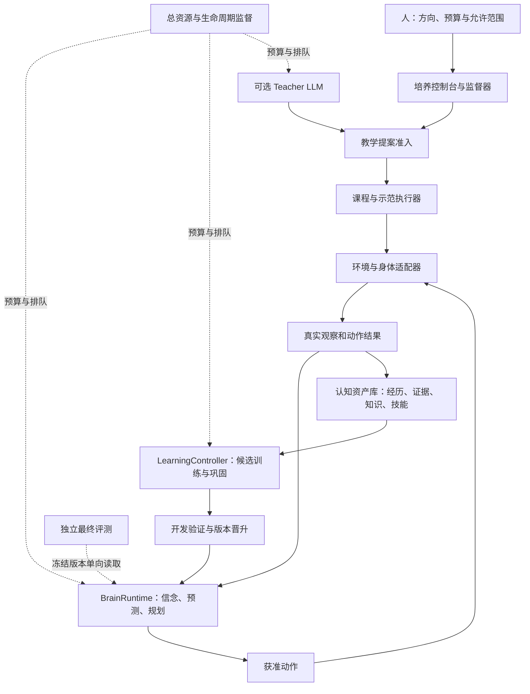

# AinerZero 架构整改规范：Mac 首版与可延续认知

版本：1.2 · 更新日期：2026-10-12 · 配套主指南：v0.5

本文将架构审查落实为后续实施约束。**经历/来源、机制声明与实验包预算已接入 C0 采集、重放、序列抽样、基线及小预测器短训练；Brain Bundle、导师适配器和控制台尚未实现。** M0 历史验收见 [M0 验收报告](M0_VALIDATION.md)。截至 M2a 的全量 [676 项测试通过](artifacts/reports/m2a-tests.xml)，[首次 100 次更新](M2A_FIRST_FIT.md) 已实际执行，但新世界预测验收失败，候选未晋升；完整 Brain-0 尚未完成。

v0.5 的 [首轮学习计划](FIRST_LEARNING_PLAN.md) 收紧模型规模、损失、规划与执行顺序。本文的分层和迁移约束保持；M0.1 先落实首个实验需要的契约，其余资产封装与完整课程可在 C0 预测实验后补齐，不要求先完成所有平台设施。

2026-09-25 更新：[M2b 诊断与对照](M2B_FAILURE_DIAGNOSIS.md) 确认旧候选高度依赖训练位置字节频率。只增加窗口符号换名的 100 次更新减少了该偏差，但预测仍近于均匀分布，未晋升候选。M2b 当时的全量 [725 项测试通过](artifacts/reports/m2b-tests.xml)；该阶段提出检验观察保留和重建，暂不扩大架构。

M2c 阶段：[观察优先培养](M2C_OBSERVATION_FIRST.md) 以更小的 393,232 参数共享符号结构通过当前观察保存/重建，动作后重建仍为 100%。架构身份独立、权重和临时状态一起保存；通用认知 Bundle、长期记忆和跨后端恢复仍未完成。动作预测未过门槛，候选不晋升；当时全量 [779 项测试通过](artifacts/reports/m2c-tests.xml)。

M2d 阶段：[变化样本与四步预测对照](M2D_CHANGED_MULTISTEP.md) 已完成。393,232 参数保持不变，三组各 100 次更新，加上两次中断中的 9 次，总计 309 次；797 项测试通过。三组重建均保持 544/544，但变化命中仍为一步 0/7、四步 0/25，均未过预测门槛且未晋升。变化加权与四步损失存在取舍，真实变化预测仍未通过，历史关联是否被使用尚待验证；下一小步先做完整/清空/打乱历史的冻结诊断和必要的短延迟读回检查，不扩模。

M2e 阶段：[冻结历史诊断](M2E_HISTORY_DIAGNOSIS.md) 已完成，0 次训练更新、权重逐张量不变，826 项测试通过。清空历史后四步总体 NLL 从 0.9190 升至 3.4011，说明携带历史形成的状态在影响预测，收益主要在不变格；打乱较早历史的首选符号差异为 0/384，三种条件的变化命中仍为一步 0/7、四步 0/25。尚不能判断是历史信息未保留还是没有被正确使用；下一步固定学生做短延迟信息读出诊断，不扩模。

M2f 阶段：[短延迟读出诊断](M2F_DELAYED_READOUT.md) 已完成，实际 11.00 秒，910 项测试通过。学生 393,232 参数保持冻结；外部读出器对过去 1/2/4 步变化符号的开发命中为 1/77、2/124、5/207，无历史两组均为 0，但其跨世界总体读出远劣于复制当前。原符号解码与当前重建仍为 100%；公开轨迹统计显示探针训练符号支持有限，不能把探针泛化失败解释为学生没有记忆。下一小步先校准外部读出：固定当前通路加残差，并加零延迟对照，暂不改学生或扩模。

M2g 阶段：[固定当前通路与残差读出](M2G_RESIDUAL_READOUT.md) 已完成，12.09 秒、962 项测试通过。零延迟原密集读出开发准确率为 70.23%，固定当前通路为 100%，确认外部读出存在泛化限制。残差三组的变化回读仍为 0/77、0/124、0/207；完整历史保住了 1/2 步未变化符号，4 步仍有损伤。学生 393,232 参数、权重未变、重建仍为 544/544，未晋升。该阶段提出转向一步上一观察保留任务，后续实测见 M2h。

M2h 阶段：[一步上一观察保留](M2H_ONE_STEP_MEMORY.md) 已完成实现、1,075 项测试和一次固定 100 次更新，实际 57.22 秒。模型仍为 393,232 参数，仅更新已有 GRU；有界符号兼容性为 256/256，但开发上一帧读回仅 5.03%、变化命中 2/77，未过筛查。原四步动作准确率从 93.49% 降至 1.82%；重建仍为 544/544。候选仅留档，原检查点未替换。该阶段提出冻结参数消融，后续结果见 M2i。

M2i 阶段：[GRU 干扰消融](M2I_GRU_INTERFERENCE.md) 已完成，42.49 秒、1,235 项测试通过，0 次训练更新。恢复候选前半参数后，四步动作准确率从 1.82% 回到 58.33%，仍低于原模型 93.49%；四步 NLL 差距仅恢复 21.89%。变化记忆仍为 2/77，总体读回降至 3.06%。原模型与候选评测逐值复现；三组权重未变、未晋升。该阶段提出验证最短写入，后续训练与结果见 M2j。

M2j 阶段：[单条反馈边记忆拟合](M2J_MICRO_MEMORY_FIT.md) 已完成。修复梯度容器兼容问题后固定训练 200 次，108.93 秒、1,402 项测试通过。16 条训练经历的 128 个符号及 29 个变化符号，在两组随机条件下均 100% 读回；连续训练记忆为 29.44%，连续开发记忆仅 1.10%、变化 0/77。一步/四步动作准确率保持 98.18%/93.49%，但 NLL 略差。393,232 参数保持，282,128 个冻结参数逐位未变，未晋升。后续配对诊断已完成，见 M2k。

M2k 阶段：[同样本零状态/历史对照](M2K_PAIRED_MEMORY_DIAGNOSIS.md) 已完成，75.14 秒、1,523 项测试通过，全部权重未变、0 次更新。已拟合样本在两种条件下均 100%；排除与拟合样本相同的上一观察后，其余训练查询为 42.63% / 34.76%。开发世界即使零状态也仅 0.37%，带历史 0.78%，但 NLL 更差、变化命中由 3/127 降至 0/127。输入泛化不足与部分历史干扰并存，未晋升。后续训练与覆盖诊断已完成，见 M2l 与 M2m-a。

M2l 阶段：[多样输入一步保留](M2L_DIVERSE_MEMORY_FIT.md) 已于 2026-10-07 完成，200 次尾部更新、230.17 秒、1,699 项测试通过。与训练池上一输入不重复的 505 条训练世界查询零状态达到 86.36%，开发世界仍仅 1.34%、历史 0%；动作准确率和当前重建保持，开发筛查失败、未晋升。

M2m-a：[零更新覆盖与槽位诊断](M2MA_SLOT_INTERFERENCE_DIAGNOSIS.md) 已于 2026-10-12 完成，158.27 秒、106,496 单位、0 次更新、权重未变；当时 1,794 项测试通过。位置未见单格替换正确率 0.10%，其他格下降 0.36 个百分点，R1 成立、R2 不成立。支持优先检验符号身份与组合覆盖，单格跨槽干扰未证实，主要机制仍未确定。

M2m 阶段 B：[一致换名执行版](M2M_CONSISTENT_RELABEL_FIT.md) 的外部运行已完成 200 次更新，333.03 秒、264,480 单位；已有 1,856 项测试记录。独立 CPU 核对复算了查询和换名池逐格结果，并核对最终冻结参数。开发零状态 409/4,096＝9.9853515625%、换名池 196/2,048＝9.5703125%，均严格低于 10%；局部两噪声仅 18/128，原判读 underfit，未晋升。开发历史 7/4,096、变化 0/127；登记动作/重建回归标记未触发，但动作变化格 NLL 变差。 后续学习率对照已完成，见下方 M2m-c。

最新已训练候选M2m-c：[学习率对照](M2MC_LEARNING_RATE_FIT.md) 200次、329.58秒、264,480单位/1,670秒预付；开发零状态95.78%、换名池97.61%，动作回归/历史未过、未晋升。C05固定 [M2m-d](M2MD_ACTION_PRESERVATION.md)，E13a/R2已按 [独立109项CPU回验](artifacts/reports/E14a-R2-independent-review-20261012.md) 限范围验收，接下来E13b接入；worker/CLI/MLX尚未完成，不直接进M2n。S01–S03已实现CPU契约、公开fixture与引用保存，[独立342项回验](artifacts/reports/S03-R1-independent-recheck-20261012.md) 全过/无xfail，限范围验收；含MLX全量本轮未重跑。保存规则和证据见 [时空保存约定](SPACETIME_STORAGE.md)、[研究记录](RESEARCH_LOG.md)、[任务清单](AGENT_TASKS.md)。

M2i 增补约束：符号编码/解码冻结、当前重建通过、GRU 前半参数不变，都不能单独证明动作动态被保护。循环状态各部分仍通过循环矩阵和后验/先验相互影响。任何记忆培养必须独立报告动作 1/4 步回归；局部短任务拟合与连续使用分别验收。此约束已纳入后续培养方向；M2j 已完成短任务拟合，连续开发记忆仍未通过。

## 1. 整改结论与实际缺口

保留随机初始化学生、RSSM 初始方案、MLX、NumPy、SQLite、safetensors、持久预算和独立评测。调整模块职责、实验归因、认知资产格式及交付顺序。首版以 M2 Max / 96GiB 为唯一已验证平台；“已适配”不等于在所有算法和框架中性能最优。

| 现状 | 缺口 | 本次设计决定 |
| --- | --- | --- |
| 规划器优先使用人工逻辑假设选择实验 | 符号求解器可能替代神经学习，混淆结果 | 神经主路线、符号基线、混合路线分别记录和验收 |
| 有随机初始化和从零原则 | 尚无可追踪的先天机制清单 | 每次运行记录机制版本、人工先验和可变状态 |
| 学生协议中包含 `learn` | 学生状态和训练权限没有清楚分开 | `BrainRuntime` 执行；`LearningController` 更新候选；晋升由独立规则决定 |
| `source_kind` 区分五类来源 | 同时承担事实性质与师生操作者身份；接管时容易重标历史观察 | 增加独立的来源、操作者、辅助信息和数据分区字段，按版本迁移 |
| 恢复点保存张量和任意 JSON | 完整性检查不等于架构、表征和身体语义兼容 | 在现有恢复点外加有类型的资产描述、兼容检查和 Bundle 层 |
| 观察是 8 格符号、动作是 0–3 | 当前并非通用身体接口 | 保留严格符号载荷，新增版本化外层信封；新模态使用新载荷注册 |
| 主指南有编码版本约束 | 没有表征空间身份与消费者检查 | 同维不同编码器不得混用；映射也须有版本和验证报告 |
| 已记录经历顺序，未来预留身体接口 | 尚无统一的时空经历与多维关联组织 | 增加第 6.4 节：3D+时间、对象/语义/因果/目标视图；当前只准备离散 C0 契约 |
| 控制台原定 M4 | M1/M2 缺少观察和教学窗口 | M1 最小实验台；M2 加真实预测；M4 完成长程控制台 |
| 配置有 adaptive 档位 | M0 没有持续调度器，导师也没有纳入总预算 | M1 起每次运行有监督与资源闸门；M4 完整自适应调度 |

## 2. 初生大脑：固定机制与可学习内容

“空白”表示不加载世界知识权重、规则答案、词义或感知标签；仍有学习算法、架构和环境接口。随机权重、任务生成器和损失函数都带归纳偏置，不能宣传为绝对零先验。

| 层 | 初始提供 | 经历可以改变 | 首版固定边界 |
| --- | --- | --- | --- |
| 学习机制 | 损失、优化器、记忆准入、回放、探索规则、巩固与晋升规则 | 后续学习策略候选、经验证的超参数版本 | 学生不得在线改写训练器、评价器或预算实现 |
| 大脑结构 | 编码器、循环状态、预测器、记忆与动作接口 | 权重、潜在表示；后续实验可替换模块 | 架构变化创建新的候选版本及兼容报告 |
| 世界知识 | 无预装规则实例与词义；概念/技能库为空 | 关系、概念关联、假设、技能、反例 | 人工编写示例不能登记成学生发现 |
| 会话状态 | 零初态、明确的随机种子、空当前目标 | 信念状态、感官缓冲、当前计划 | episode reset 与模型/身体切换有显式重置或迁移规则 |

每个运行的 `MechanismManifest` 记录：架构与初始化版本、损失/优化器、规划/探索实现、记忆策略、假设语法、输入/动作规范、课程生成器、教师条件、代码版本或源码摘要，以及哪些组件固定、哪些可学习。配置哈希不能替代代码与算法版本。

三种成长使用不同证据：

1. **知识成长**：新经历使陌生样本预测改善，反例能让旧结论降级。
2. **策略成长**：在未见任务族、相同预算下，学会更有效地观察、探索或求助；与固定规则对照。
3. **算法成长**：提出学习器或结构候选，在隔离实验中比较新任务适应和旧能力保持，再决定晋升。首版只登记接口，M5 前不开放任意代码自改。

“第二次学得快”需分别消融经历记忆、神经表征、探索策略与更新规则；不能仅据此称为发明算法。

## 3. 模块职责与依赖方向



- `BrainRuntime`：观察、信念更新、预测、计划；内部可使用 MLX 张量。稳定版本不被优化器直接修改。
- `LearningController`：选择合规训练数据、预留预算、调用 MLX learner 更新候选、记录指标、请求开发验证。它属于学习系统，但不属于学生可自行修改的权限面。
- `CognitiveStore`：资产、版本、引用、查询与一致性；不得导入 MLX/PyTorch 或执行模型代码。
- `TeacherAdapter`：读取允许的训练/开发摘要，提交有类型的提案；没有模型权重、证据库任意写入及最终测试访问权。
- `BodyAdapter`：提供可观察信号和获准动作，内部真值只给环境恢复器与隔离评测器。
- `Supervisor`：单一预算、GPU 调度和状态真相来源；CLI 与 Web 使用同一服务入口。

模块划分优先用同一 Python 工程内的接口，不建立六套微服务。数值计算保留 MLX 原生表达与编译能力，不先造通用 Tensor 运算封装。只有持久化和跨进程边界使用 JSON、NumPy 数组或受控共享缓冲；不逐步把 GPU 张量搬回 Python 做业务判断。

`learning/` 的控制逻辑与 `learning/mlx/` 的损失/更新实现分开；`brain/mlx/` 放网络与数值推理。未来第二后端出现时实现相同高层语义契约，首版不写空的 CUDA/PyTorch 实现。

## 4. 三条能力路线与教学条件

实验身份使用两个正交字段，不能把“无 LLM”当成“没有人工符号先验”。

| 维度 | 取值与约束 |
| --- | --- |
| `reasoning_route` | `neural`：RSSM 预测/CEM 与神经分歧探索；`symbolic`：受限逻辑推断基线；`hybrid`：显式组合两者 |
| `teaching_condition` | `none`、`human_demo`、`llm_curriculum`、`llm_demo`；允许进一步登记组合条件 |

默认研究主路线为 `neural + none`。它仍有人工学习机制和公开任务目标，但不接收符号求解器的预测、答案、合成监督标签或选好的干预动作。符号模块可在旁路做诊断；一旦结果进入行动选择、课程选择或训练标签，就必须登记相应辅助或混合条件。

用户选择的“早期引导、逐步放手”用于产品培养模式，可默认由人引导；它与纯自主研究对照并存，不能覆盖无示范对照的定义。

独立评测默认关闭导师，冻结记忆可用范围、模型和动作策略。需要研究测试时求助时，另开“辅助执行”条件，把求助次数、时延和成本纳入报告。

## 5. Teacher LLM 与最小培养控制台

### 5.1 结构化提案

`TeacherProposal` 最少包含：提案 ID、教师模型/版本、输入摘要引用、目标能力 ID、课程/环境版本、允许的参数修改、示范数量上限、预估交互/时长/推理预算、过期时间和原始输出审计引用。

教学准入状态：`proposed → admitted/rejected → running → completed/failed/expired`。已经由用户批准的课程范围和预算内可自动准入；新增网站、设备动作、支出或范围变更才提交用户决定。提案自身填写 `approved` 不产生授权。

教师先提交建议，由现有环境实际执行示范，记录真实动作与反馈。LLM 编写的观察 JSON、口头规则和图像标签仍是教师主张/外部标注，不能冒充传感器事实。规则直接讲授属于单独监督路线；首版不通过给学生塞文字备注假装完成教学。

教师调用超时、不可用或输出不合规时，记录失败；已有课程可继续在原预算内运行，否则等待人或固定课程策略。学生不依赖导师常驻才能推理。导师不能访问最终评测种子、真值、单样本结果；读取受控开发摘要的次数与内容也须审计。

### 5.2 教学路线的公平比较

预先登记两类比较：等学生交互预算、等系统总成本预算。总成本包括课程生成、示范环境动作、教师推理、学生训练、探索与评测；共享教师产物的生成成本须公开摊销规则。多进程重叠时项目墙钟活动时长按时间区间并集计费，组件 CPU/GPU 时间另列，不把重叠时长重复算成墙钟时间。

两组使用相同任务分布和匹配种子，教师可自适应选课但不能接触测试答案。主报告同时列出学生用量与师生总用量。只在等交互条件下提升，结论限定为交互效率提高。

### 5.3 控制台前移

M1 提供本地单页实验台：主体观察、动作/结果时间线、来源、手动示范、开始/暂停/恢复/停止和剩余预算。M1 没有模型时显示“尚无预测模型”；不能填演示分数。

M2 增加真实预测对实际结果、当前候选/稳定版本和训练曲线。M3 再接入可选 LLM 教学提案工作台。完整能力、记忆、感官与长程调度页面仍在 M4；所有按钮复用同一生命周期入口。

## 6. 认知资产、表征和概念身份

### 6.1 四类持久资产和独立会话状态

| 类别 | 内容 | 更换后端或身体时的处理 |
| --- | --- | --- |
| 经历 | 原始观察引用、请求/执行动作、结果、顺序、采集条件与来源 | 保持字节和引用；保留传感器与动作版本后重新解码/编码 |
| 抽象知识 | 概念修订、关系、可执行假设、范围、证据与反例 | 使用带版本的表示语言；先检查解释器和前提兼容，再验证预测 |
| 技能 | 目标、前置/终止条件、策略或动作程序、失败信号与身体依赖 | 知识索引可保留；动作绑定不兼容则不可执行，重学控制层后再验收 |
| 神经模型 | 结构、预处理、参数、数值规则和训练谱系 | 需要同架构兼容实现或显式转换与数值验证 |
| 会话状态 | 当前 belief、RNG、待完成动作、环境快照、回放游标、课程进度 | 仅兼容恢复模式加载；认知导入不能自动恢复身体动作或训练 |

派生特征是可重建缓存，按表征空间分区，不单独承担永久知识。受存储或授权限制无法保存全部原始媒体时，明确标记原件缺失、不可再编码和证据可复现性下降，不承诺无损迁移。

### 6.2 表征空间身份

每条 `RepresentationRef` 至少关联 `encoder_id`、`encoder_revision`、`weights_hash`、`preprocessing_revision`、`representation_schema`、形状/dtype、源观察 ID/内容哈希和产生该表示的模型版本。

`representation_space_id` 的哈希只包含编码器/权重、预处理与表征 schema；源观察 ID/哈希是样本引用，不进入空间身份，否则每个样本都会错误地产生新空间。同为 128 维不代表兼容。查询、回放加载器与规划器都检查空间身份；没有已验证的转换就拒绝混用。跨框架数值转换即使语义目标相同也保留转换谱系，不能直接伪装成原权重文件。

编码器训练持续变化时，持久特征只对不可变编码器快照建版本；训练批次优先从原始观察重新编码。短期在线特征按模型代次失效，不为每个优化步创建永久概念记录。

迁移映射记录源/目标空间、训练经历分区、校准报告和失效条件。映射只在验证范围内可用，不能因为维度对齐就宣称概念相同。

### 6.3 概念与可执行知识

概念身份使用全局唯一 ID 加不可变 revision；中文、英文、声音和向量是可修订关联。概念 ID 只解决追踪，不证明模型理解该概念。同一概念的范围或关联修订保留 ID、追加 revision；拆分/合并产生新 concept ID，并保存 `supersedes/split_from/merged_from` 谱系。旧 ID 保留，历史证据仍引用当时修订，不覆写历史。

`KnowledgeRecord` 保存 `producer`、发现机制、表示语言/版本、结构化表达式、作用域、支持/反例 ID、校准样本及指标、模型/编码器版本和候选/验证/失效状态。工程师或教师创建的条目不得标记为学生发现。

条件与预测采用有类型的 AST 和登记的有限解释器，字段指向可测观察或概念修订；自由文本只能是备注。禁止直接 `eval` 导入字符串。早期 AND/OR/XOR 来自人工语法，报告的是该语法内的规律推断能力。

知识可靠性与来源可信度分开记录。没有验证样本时校准值为空；支持、反例、置信区间和适用范围不能被一个主观百分比替代。概念修订可以只作为候选索引，尚未接入预测/规划时不得宣称它已成为可用能力。

### 6.4 时空经历与多维关联（S01–S03 CPU契约/公开样例/保存已验收）

长期目标是记录对象在**三维空间和时间中的变化**，并用这些经历关联概念、关系、动作、因果假说和目标。这里的 **4D＝x/y/z＋t**。语义、因果和目标是不同类型的关联，不能把它们当作与米、秒相同的坐标，也不能仅靠增大 latent 维数获得多维推理。

采用**同一证据底座上的时空索引与关联视图**。保留原始观察，位置、对象身份和含义是带来源的可修订估计；这些视图以后辅助检索、状态估计、预测和规划，不取代神经模型。当前代码仍是八格符号载荷，没有三维感知、对象跟踪或语义推理能力；新增结构是研究人员提供的机制，不是学生已经自行学出的知识。

| 逻辑记录 | 内容和边界 |
| --- | --- |
| `TimeIndex` | run/世界/episode/step/流序号，事件或采样时间、接收时间、clock domain、时间区间及误差；未知秒数留空，事件步不能冒充秒 |
| `SpatialEstimate` | 有类型的 `symbol_slot / grid_xy / image_xy / body_xyz / world_xyz`，坐标系 ID/修订、单位、有效时间、身体/传感器版本、位置/姿态或范围、不确定性依据及观察引用 |
| `EntityTrack` | 有世界作用域的对象实例 ID、持续身份候选、轨迹修订、支持观察和遮挡/未知状态；不是类别 `concept_id`，跨世界身份不能仅凭同名合并 |
| `SemanticBinding` | 对象或事件与概念修订、词语、属性、动作的关联；保存发现者/命名者、辅助条件、证据及反例；词语和向量不作为概念本体 |
| `RelationEvidence` | 对象间空间/时间关系、动作—结果、候选因果、目标条件、技能前提的有类型引用；相继发生不自动标记已验证因果 |
| `ImaginedBranch` | 起始信念及当时可用证据、模型/机制版本、假设动作、预测跨度、父分支和预算；预测、反事实与真实经历分别查询 |

这些是逻辑视图，继续复用 SQLite 索引、原始轨迹和 NumPy 分片，先不引入空间数据库、完整场景重建或新的大模型。向量仍按编码器/表征版本保存；几何坐标按坐标系/标定版本保存。两种版本不能相互代替。


必须遵守的时空边界：

1. **像素、格子和真实空间分开。** 单目像素不自动给出深度；不能补 `z=0` 后称为三维。C0 只引用第几个符号格，物理坐标为空；索引结构不证明学生理解了空间。
2. **同一时间和坐标依据才比较。** 跨时钟需要同步依据与误差，跨坐标需要带时间的变换/标定；保存坐标轴、方向、单位和身体版本。缺少依据时返回不可比较。摄像机/身体运动与对象运动分别估计，不把画面位移直接当物体位移。
3. **保留当时所知与后来的修订。** 状态估计记录有效时间和首次可用的事件序号；用未来帧修订轨迹时追加版本，保留原在线信念/预测。查询时不能读到之后才获得的身份、位置或语义。
4. **不确定与不可见分别表达。** 遮挡不代表对象消失；可见、遮挡、失去跟踪、未知是不同状态。无校准证据时置信值为空，不能根据文案填概率；多个身份假说可以并存。
5. **来源与反事实不混合。** 仿真私有对象 ID/坐标只给评测器；公开传感器、学生估计和教师标签分别登记。教师提供名字或规律属于辅助。想象分支须经实际结果检验才形成新的支持证据，不能通过自我引用成为事实。

未来的多维使用是一个受限过程：按时间、位置/对象、概念和目标条件检索证据 → 更新信念 → 在登记范围内比较动作预测 → 根据真实结果修正。能存记录、能检索、能正确预测、能改善行动是四个不同验收等级。自然语言如“它刚才在哪里、被什么动作改变、如何拿到它”只是未来用途示例；当前 Brain-0 不因系统存在这些中文描述就理解问题。

| 阶段 | 最小交付 | 能声称什么 |
| --- | --- | --- |
| 当前 CPU 准备 | `TimeIndex`、C0 格引用和有类型证据关联；追加旁路索引，保持 v2 原文件/训练输入不变 | 可追溯、可排序、来源/维度不混用；尚未模型使用 |
| 符号记忆与动作验收后 | 受控二维 GridLab 的对象持续性、遮挡和时序预测 | 指定二维任务能力，不宣称现实物理 |
| 二维能力稳定后 | 小型有标定 3D 仿真，位置/姿态/视角变化与身体坐标转换 | 登记世界内的 3D+时间预测；不要求先接 UE、机器人或完整场景重建 |
| 语言阶段 | 20–50 个命名与已学对象/动作/目标关联，保留未见组合 | 有限语义绑定及组合使用；不宣称全知或广泛自然语言理解 |

二维基础通过后，3D 与有限语言可以按独立预算交错推进；语义绑定不要求先完成全部 3D 系统。每轮只新增可独立验收的一项，持续模型执行仍由同一资源监督路径调度。

验收分别比较记录完整性、对象身份保持、位置随时间的预测、语义绑定与行动收益。使用复制当前、恒定位置/简单运动外推、仅当前观察、关闭关联视图等对照；按完整世界/episode 分区，单列遮挡、相似对象混淆、未见路径和命名组合。门槛在对应任务登记时确定，不能提前声称已通过。

## 7. 身体与事件契约

保留 M0 的严格 `SymbolObservation`，未来以版本化 `ObservationEnvelope` 包装；不把载荷改为任意字典。一个 `BodyManifest` 声明传感器/动作规范、采样率、时钟域、坐标系、单位、延迟、故障和可恢复性。符号身体中不适用的物理字段显式为空。

新增模态通过登记的 schema 解析器接入。模型只接收主体视图；完整快照、真值和管理员调试视图独立存储。像素/音频接口的预处理也要登记，未经标注不能混入现成视觉模型生成的语义。

事件 v2 拆分：

- `origin_kind`：传感器实测、教师主张、想象或外部推导；含 `parent_record_ids` 和变换来源。
- `actor_kind`：学生、人类教师、LLM 教师、基线或系统；含操作者/策略版本。
- `assistance`：课程提示、示范、标签或规则辅助，关联提案和执行记录。
- `dataset_partition`：训练、开发、最终测试。评测分区不是观察者可以自己更改的标签。

同一真实观察无需因下一步由教师接管而改写来源；训练转换从动作执行者和完整谱系计算是否属于示范。`TrainingTransitionV2` 可连接同一身体/episode 中的合法交接，但仍拒绝主张、想象及评测内容成为事实训练转换。由受信任的采集/评测控制器赋值分区，加载器验证，不能靠外部发送者自我声明。

旧 v1 保留读取：`teacher_demo` 表示真实示范经历但操作者细节可能未知；`eval_only` 隔离，不自动猜测开发还是最终测试；不确定来源不得升级为纯自主证据。显式转换不修改原始文件，转换报告保存无法恢复的字段。

事件排序使用流 ID、episode step、sequence 和请求/结果关联；单调时间只在声明的 clock domain 内比较，跨进程/重启不能直接排序。M1 服务入口统一生成 UUID run ID，与现有记录一致；旧 M0 的 `m0-cpu-*` 自检 ID 作为历史测试标签保留，不伪造为学生经历。

第 6.4 节的时间、空间和关联引用作为版本化外层记录接入，不扩成任意载荷字典。身体 manifest 登记坐标变换及其标定/有效时间，媒体流按实际采样时间组织；未知采样间隔不能由帧号直接推算秒。原始观察与在线可用序号由采集路径保存，后来补充的估计不能倒写成当时已知事实。

动作规范包含语义版本。动作编号置换或身体变更使原技能绑定失效，必须重新绑定并测试。导入知识不会复制源机器的网站/执行权限。

## 8. Brain Bundle 与恢复点

Bundle 是不可变资产封装和兼容性说明，复用现有恢复点的完整性能力；不把已通过 M0 的底层容器直接叫作完整大脑导出。

```text
brain-bundle/<bundle_id>/
  manifest.json                 # 模式、依赖、版本、文件清单/大小/哈希
  cognition.sqlite              # 知识、技能、证据索引的一致快照
  episodes/                     # 保留的原始经历及载荷
  representations/<space_id>/    # 可选派生缓存
  models/<model_version>/        # 权重与 model_spec.json
  skills/                       # 有类型技能程序或策略引用
  state/                        # 仅续训/会话恢复模式
  evaluations/                  # 可分享报告与开发数值探针
```

| 导出模式 | 必需内容 | 不承诺的能力 |
| --- | --- | --- |
| `cognition` | 经历、知识、技能与来源闭包；不可导出的载荷明确列为缺失依赖 | 不保证恢复神经网络能力；不自动执行技能 |
| `inference` | cognition 可选；权重、架构、参数命名/形状/布局、预处理、动作/观察规范和数值探针 | 不保证继续同一优化轨迹 |
| `resume` | inference 与其引用资产，加优化器/EMA/RNG/回放游标/环境/课程/预算/待执行状态 | 不保证跨后端位级复现；外部身体可能无法恢复 |

`manifest` 记录 `bundle_schema_version`、导出模式、资产根 ID、模型/身体/机制版本、生产后端、依赖及兼容级别、文件清单和已知遗漏。加载顺序是结构/大小/哈希 → 引用闭包 → schema/架构/张量/表征兼容 → 数值探针 → 授权运行。必需依赖缺失则拒绝对应导出模式；提前声明不可导出的可选原件允许保留缺失引用，但降低可复现/再编码能力，不能伪造引用闭包完整。兼容级别用 `unsupported / load_only / inference_verified / resume_verified`，不提供含糊的 `portable: true`。

导出先暂停在一致边界，固定已写入事件序号和分片范围，再做 SQLite 一致备份及清单发布；不直接复制运行中的 WAL 主文件。备份接口依据 [Python SQLite 官方文档](https://docs.python.org/3.12/library/sqlite3.html#sqlite3.Connection.backup)。权重文件的通用性只覆盖张量存储，模型语义仍需独立规范，见 [safetensors 文档](https://huggingface.co/docs/safetensors/index)。

Bundle 中不携带凭据、自动授权或最终测试真值；受限制原件引用如无法搬迁，导出说明保留其内容身份及限制。导入只读预检后进入新命名空间，不覆盖当前稳定模型；同 ID 同哈希去重，同 ID 不同哈希拒绝冲突。导入不执行代码、教师文本或待执行外部动作。

时空资产导出保留时间域、坐标系/变换/标定、对象与概念修订、在线可用顺序以及各视图的证据闭包。换身体或缺少有效变换时，旧经历仍可追溯，但几何比较/技能控制标记为不兼容，不能直接套用旧坐标。预测分支可以保存为独立研究资产，不导入真实观察视图。

同后端续训继承原 run 谱系、已消耗计数和原墙钟截止时间，迁移等待也不重置墙钟；执行额度同时受原剩余预算及目标机器当前项目日预算约束，取更严格限制，不能用源机器控制库覆盖本机账本。复制 Bundle 不能重复兑换同一恢复预算。本机控制库的导入/恢复 claim 绑定运行谱系，而非仅绑定可复制的 Bundle ID。跨机器无共享预算协调时，不承诺全局防重复，必须由外部监督器确认旧任务停机并完成额度交接；普通权重导入的新实验也须获得新运行预算并保留来源，不得自动循环重建运行。

跨框架没有可验证的优化器/RNG 等价转换时，只允许权重初始化新实验，明确标记 `weights_only_fork`；不能声称是精确续训。编译缓存、内存地址、进程句柄和硬件权限不属于可迁移认知。

## 9. Mac 首版实现策略

继续使用本机已验证的 Python 3.12、MLX 0.32.2/Metal、NumPy、SQLite 和 safetensors。MLX 针对 Apple Silicon 统一内存设计；这支持当前选择，但不构成所有负载下最快的证明。[MLX 统一内存说明](https://ml-explore.github.io/mlx/build/html/usage/unified_memory.html)

首版 CPU 承担环境与索引，GPU 承担批量模型计算；一个项目监督器分配 GPU 使用权，训练、GPU 评测、本地教师重推理默认互斥。评测即使使用独立进程也必须领取同一个 GPU 时段，不能绕过资源管理。

导师默认关闭；接入已有免费本地服务前先探测可用性与内存，不假定服务可以由本项目卸载。自己的教师进程可以按生命周期卸载；外部常驻模型占用视为不可回收的系统负载，暂停学生不会自动释放它。计算总预算时纳入教师权重、KV cache、学生稳定/候选权重、优化器、激活、回放、缓存及环境进程；统一内存统计不重复相加。

保留活跃 16GiB / 空闲最高 64GiB 的项目总预算与 16GiB 系统余量。它们是上限；实际可用内存决定分配。GPU 数量、batch 和进程数均通过负载实测选择；符号环境先比较单进程向量化与多进程，极小环境不预设越多进程越快。需要多进程时使用 `spawn` 并批量传输轨迹，避免逐事件复制与同步。

这些是完整阶段的扩展档位；v0.5 首轮 pilot 使用更严的项目 8GiB、micro-batch 4/8、有效 batch 16 和 FP32，所有校准合计最多 15 分钟。pilot 空闲时也不能自动放大到完整阶段资源表。

完整阶段 M1 校准环境、存储、消息及最小控制台；RSSM 的 BF16、梯度累积和 eager/compiled 对照在 M2 的独立扩展实验中安排，不能在模型未实现时宣称完成训练校准。首轮 pilot 不执行全部对照，以前段总 15 分钟上限为准。先 FP32 正确性，再比较固定形状编译和 BF16；MLX 编译有首轮成本和重编译条件，必须分开报告预热与稳定结果。[MLX 编译文档](https://ml-explore.github.io/mlx/build/html/usage/compile.html)

运行中的模式切换发生在有界训练小步或 episode 边界；平台接口预留电源、空闲、内存压力和热状态。M1/M2 至少实现启动前和小步间检查、手动暂停及超时；M4 才承诺完整自适应与长期无人值守调度。读取失败采用保守档位，不伪造传感数据。

未来 CUDA 首先评估同一 MLX 实现的兼容性，再决定是否需要 PyTorch。当前 MLX 官方已经列出 Linux CUDA 安装路径；本项目未在 CUDA 上执行验证，也不安装第二后端。[MLX 安装与 CUDA 支持](https://ml-explore.github.io/mlx/build/html/install.html#cuda)

## 10. 迁移与新增感官的验收

| 级别 | 验收内容 | 可以做出的结论 |
| --- | --- | --- |
| P0 文件与认知完整 | 普通 CPU 工具可读、哈希/引用一致、缺失项明确、无需 MLX 导入 | 资产可读取和追溯 |
| P1 模型行为 | 固定观察/动作/初态下比较输出分布、状态更新、1/4/8 步展开及任务指标 | 在登记任务和容差内推理兼容 |
| P2 学习恢复 | 同后端恢复优化器/随机状态/回放，继续相同轨迹；跨后端另测梯度、更新和统计学习曲线 | 仅对通过组合声明可续训 |
| P3 认知迁移 | 换符号、视角或身体后，与重新训练/只迁移记忆/只迁移权重等受控对照 | 有证据的泛化或适应收益 |

P1 首先使用约定的潜变量样本或确定性均值路径隔离 RNG 差异，再做多种子分布/任务比较；动作近似平分时不能只凭 argmax 一次不一致判定全部失败。容差在看结果前按精度与算子登记，不能把 M0 小网络误差直接当 RSSM 的标准。

新增视频适配器先做少量有授权素材的实验室：时间戳、帧/音频抽样、暂停/回看/区域选择结果与原件哈希。剪辑和观察相关性不等于可控干预；视频发现的假设应到可交互环境验证，不能把仿真验证范围扩大为现实物理定律。M6 先低分辨率受控视觉，M8 再扩展检索；静止场景也需低频全局采样，避免只采变化漏掉信息。

互联网权限与下载/域名/时长预算由监督器执行；外部网页是内容来源，无权修改机制、评价器或权限。视觉/语音教师的语义输出也计入教师路线。UE、3DGS 和机器人属于新身体或表示接口，不是直接给旧大脑接一根线就获得新能力。

## 11. 可执行整改顺序

### M0.1：新增契约与资产边界，部分实施

这是进入 M1 前的小阶段，不重写已通过的 M0，也不实现完整知识图谱、CUDA 或所有感官。概念发现/合并算法、知识数据库业务写入、可执行 AST 解释器和完整恢复导出均留到对应模块阶段；此时只定义严格引用、版本和兼容边界。

分两步落实：M0.1a 完成 C0 学习需要的 ID、机制/实验身份、来源/分区与版本契约；M0.1b 在有真实经历后补 Bundle P0 和兼容测试。M1a C0 与 M2a pilot 可在 a 完成后推进；整套 M0.1 未过验收仍标为部分完成。首个多运行实验前必须补齐实验包总预算，不能靠多个 run 各自限额替代。

- [ ] `core/identity.py` 与 `core/provenance.py`：统一 ID、机制/实验条件、事件 v2 来源与分区；保留 v1 显式读取迁移。
- [ ] `core/assets.py`：身体/模型/表征描述、带修订的概念和技能引用；校验有类型的枚举、内容哈希与依赖。
- [ ] `memory/bundle.py`：最小 cognition Bundle 的 manifest、不可变发布和只读预检；用小型合成经历验证，不制造学成的概念。
- [ ] `runtime/compatibility.py`：实现 P0 检查与推理/续训的能力声明接口；未实现的模式明确返回 unsupported。
- [ ] 整合配置：`reasoning_route`、`teaching_condition`、教师默认关闭；教学许可与实验实际用量分开。配置 schema 迁移不能用忽略未知字段代替。
- [ ] 回归验收：跨进程师生接管不重标观察；评测/主张拒绝入回放；异表征空间拒绝混用；Bundle 损坏/必需依赖缺失/版本冲突失败且不覆盖旧数据，可选原件缺失正确降级；无 MLX 导入即可检查资产；现有 172 项 M0 用例继续通过。

前两个小步集中在 `core/experience.py`、`core/experience_migration.py`、`core/pilot.py` 和现有 `RunStore`，暂不为每种元数据拆一个模块。已落实 run/episode/环境身份、动作决策者、来源与分区校验、请求/结果关联、训练准入、旧记录隔离转换，以及首轮机制/实验配置声明、源码摘要和实验包总预算。M1a 已通过 `environments/c0.py`、`data/trajectory.py` 和 `runtime/c0_collection.py` 打通受限采集/公开轨迹/私有审核状态的分离；`data/sequences.py` 实现均匀完整窗口抽样。学习机制现为 `c0_prediction_only`，规划器仍为 `planned`；首次短训练未通过预测验收。完整资产、持续回放策略和通用回放数据库尚未完成，所以上述整项仍保持未完成。校验针对声明结构，不验证外部生产者真实性，也不提供完整父证据解析。

### M1–M5 与后续

| 阶段 | 本轮修订后的交付 | 完成条件 |
| --- | --- | --- |
| M1 | SwitchLab、可重放经历、三类基线、最小实验台、环境/存储校准 | 来源隔离、动作顺序、手动控制与预算真实贯通；不展示虚构模型预测 |
| M2 | MLX Brain-0、独立学习控制器、神经主路线、真实预测面板、模型导出及同后端恢复 | 神经预测/行动独立过门槛；P1/P2 在已验证本机组合通过；训练资源校准 |
| M3 | 主动探索、混合路线、知识/假设引用、可选 Teacher Adapter | 与神经/符号/无教师对照分开；教师输出不绕过采集、预算与评测 |
| M4 | 完整培养控制台、长期资源调度、候选晋升、完整恢复 Bundle | 真实暂停/恢复、资源让路、旧能力回归与权限范围检查 |
| M5 | 多种子独立研究验收、教师效率和迁移归因报告 | 分开已学能力、导师帮助、人工结构贡献与未通过项 |
| M6–M8 | 视觉、语言、技能、视频实验室、受控互联网及后续身体 | 每次新增接口做 P0–P3 中相关验收；不提前承诺跨身体无损延续 |

当前代码的 `brain0.yaml` 仍是 M0 schema v1；本文新增字段暂未写入运行配置，避免制造“能配置但不生效”的入口。实施上述条目时同步迁移代码、配置、测试和主指南状态。

时空准备按 [S01–S04 执行任务](AGENT_TASKS.md) 分步落实；当前只允许不改变学生输入的 CPU 契约/索引准备。M2m-c 已完成的学习率对照保持单因素记录，不能倒写时空字段、语义标签或新损失为这轮训练的一部分。

2026-10-12交接：M2m-c完成且未晋升，C05固定 [M2m-d](M2MD_ACTION_PRESERVATION.md)，E13a/R2 CPU层已按独立109项回验验收，当前E13b独立训练入口待实现。S01–S03基础契约/公开样例/固定fixture/引用保存已实现，[342项独立CPU回验](artifacts/reports/S03-R1-independent-tests-20261012.xml) 全过；保存身份/路径见 [约定](SPACETIME_STORAGE.md)。含MLX全量未重跑，原作者/报告/数据保留；采集索引接入/完整时空或语义能力仍未完成，未训练/提交。

长期资产是**可追溯的经历、显式知识、技能、权重及验证证据的组合**。显式知识便于迁移和解释，但无法保证从权重中无损提取所有认知；更换计算器官或身体后的能力延续必须靠测试确认。
