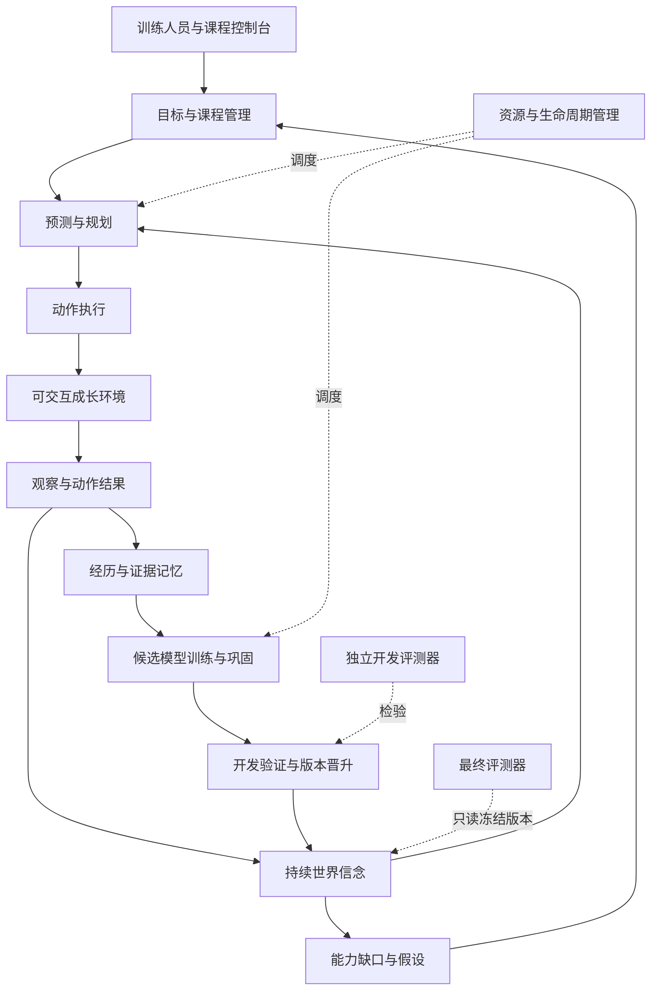

# AinerZero 发育式世界模型实现指南

版本：0.5 · 更新日期：2026-09-30 · 首个目标平台：Apple M2 Max / 96GB 统一内存

本文是项目的实施基线，统一愿景、学习架构、培养方式、硬件使用、工程接口和验收顺序。后续实现按本文的里程碑推进，并把实际结果写回进度表。

v0.4 已纳入本轮 [架构整改规范](ARCHITECTURE_REVISION.md)：明确先天机制与后天知识、神经/符号/混合路线、可选 LLM 导师、认知资产与计算后端分离、Brain Bundle，以及前移的最小控制台。该规范是本文的配套实施约束；新增模块目前仍是设计，具体实施切片以 v0.5 的首轮学习计划为准。

v0.5 进一步按“只有现有 Mac、零新增付费服务、尽早获得真实学习结果”收紧执行范围。首轮采用 [首轮学习实验方案](FIRST_LEARNING_PLAN.md)：约 65 万参数的预测核心、C0 纵向切片、直接动作后果预测损失、明确支持/查询协议和实验包总预算。约 1,540 万参数配置改为扩容候选；不等待完整平台建成才验证学习。首次 100 次更新已执行，开发预测验收未通过；预算仍是上限而非效果或完成时间承诺。

**截至 M2a 的状态：M0 工程底座已通过验收，见 [M0 验收报告](M0_VALIDATION.md)。C0 采集/重放、均匀序列抽样、复制/无动作基线和 MLX 小预测器训练已贯通，全量 [676 项测试通过](artifacts/reports/m2a-tests.xml)。[首次短训练](M2A_FIRST_FIT.md) 完成 100 次更新和候选保存检查，但新世界预测变差，候选没有晋升。完整 Brain-0、C1–C4、长期训练调度和控制台仍待实现；下文的完整阶段资源档位与能力门槛仍是目标。**

2026-09-25 更新：[M2b 失败诊断](M2B_FAILURE_DIAGNOSIS.md) 已通过冻结干预确认旧候选偏向训练位置字节频率、符号输入利用极弱。随后仅增加符号换名增强，完成另一轮 100 次更新；开发 1 步 NLL 从 9.52 降到 5.59，但仍近于均匀预测，验收未过、候选未晋升。M2b 当时的全量为 [725 项测试通过](artifacts/reports/m2b-tests.xml)。该阶段提出先验证观察的保留与重建，不扩模。

M2c 阶段进度：[观察优先实验](M2C_OBSERVATION_FIRST.md) 已通过当前观察保存/读回门槛。共享符号结构缩小到 **393,232 参数**，开发重建 544/544 正确、八个位置均 100%；动作训练后重建 NLL 0.0996，保存检查通过。100 次动作更新后的 1/4 步预测 NLL 为 0.3362 / 1.1382，仍未超过复制基线，未晋升候选。当时全量 [779 项测试通过](artifacts/reports/m2c-tests.xml)；该阶段提出继续处理变化样本与多步误差，不扩模。

M2d 阶段：[变化样本与四步预测对照](M2D_CHANGED_MULTISTEP.md) 已完成。393,232 参数保持不变，三组各 100 次更新，加上两次中断中的 9 次，总计 309 次；797 项测试通过。三组重建均保持 544/544，但变化命中仍为一步 0/7、四步 0/25，均未过预测门槛且未晋升。变化加权与四步损失存在取舍，真实变化预测仍未通过，历史关联是否被使用尚待验证；下一小步先做完整/清空/打乱历史的冻结诊断和必要的短延迟读回检查，不扩模。

M2e 阶段：[冻结历史诊断](M2E_HISTORY_DIAGNOSIS.md) 已完成，0 次训练更新、权重逐张量不变，826 项测试通过。清空历史后四步总体 NLL 从 0.9190 升至 3.4011，说明携带历史形成的状态在影响预测，收益主要在不变格；打乱较早历史的首选符号差异为 0/384，三种条件的变化命中仍为一步 0/7、四步 0/25。尚不能判断是历史信息未保留还是没有被正确使用；下一步固定学生做短延迟信息读出诊断，不扩模。

M2f 阶段：[短延迟读出诊断](M2F_DELAYED_READOUT.md) 已完成，实际 11.00 秒，910 项测试通过。学生 393,232 参数保持冻结；外部读出器对过去 1/2/4 步变化符号的开发命中为 1/77、2/124、5/207，无历史两组均为 0，但其跨世界总体读出远劣于复制当前。原符号解码与当前重建仍为 100%；公开轨迹统计显示探针训练符号支持有限，不能把探针泛化失败解释为学生没有记忆。下一小步先校准外部读出：固定当前通路加残差，并加零延迟对照，暂不改学生或扩模。

M2g 阶段：[固定当前通路与残差读出](M2G_RESIDUAL_READOUT.md) 已完成，12.09 秒、962 项测试通过。零延迟原密集读出开发准确率为 70.23%，固定当前通路为 100%，确认外部读出存在泛化限制。残差三组的变化回读仍为 0/77、0/124、0/207；完整历史保住了 1/2 步未变化符号，4 步仍有损伤。学生 393,232 参数、权重未变、重建仍为 544/544，未晋升。该阶段提出转向一步上一观察保留任务，后续实测见 M2h。

M2h 阶段：[一步上一观察保留](M2H_ONE_STEP_MEMORY.md) 已完成实现、1,075 项测试和一次固定 100 次更新，实际 57.22 秒。模型仍为 393,232 参数，仅更新已有 GRU；有界符号兼容性为 256/256，但开发上一帧读回仅 5.03%、变化命中 2/77，未过筛查。原四步动作准确率从 93.49% 降至 1.82%；重建仍为 544/544。候选仅留档，原检查点未替换。该阶段提出冻结参数消融，后续结果见 M2i。

M2i 阶段：[GRU 干扰消融](M2I_GRU_INTERFERENCE.md) 已完成，42.49 秒、1,235 项测试通过，0 次训练更新。恢复候选前半参数后，四步动作准确率从 1.82% 回到 58.33%，仍低于原模型 93.49%；四步 NLL 差距仅恢复 21.89%。变化记忆仍为 2/77，总体读回降至 3.06%。原模型与候选评测逐值复现；三组权重未变、未晋升。该阶段提出验证最短写入，后续训练与结果见 M2j。

M2j 阶段：[单条反馈边记忆拟合](M2J_MICRO_MEMORY_FIT.md) 已完成。修复梯度容器兼容问题后固定训练 200 次，108.93 秒、1,402 项测试通过。16 条训练经历的 128 个符号及 29 个变化符号，在两组随机条件下均 100% 读回；连续训练记忆为 29.44%，连续开发记忆仅 1.10%、变化 0/77。一步/四步动作准确率保持 98.18%/93.49%，但 NLL 略差。393,232 参数保持，282,128 个冻结参数逐位未变，未晋升。后续配对诊断已完成，见 M2k。

最新 M2k：[同样本零状态/历史对照](M2K_PAIRED_MEMORY_DIAGNOSIS.md) 已完成，75.14 秒、1,523 项测试通过，全部权重未变、0 次更新。已拟合样本在两种条件下均 100%；排除与拟合样本相同的上一观察后，其余训练查询为 42.63% / 34.76%。开发世界即使零状态也仅 0.37%，带历史 0.78%，但 NLL 更差、变化命中由 3/127 降至 0/127。输入泛化不足与部分历史干扰并存，未晋升。下一步保持小模型、零状态和一步任务，先增加训练输入多样性；该训练尚未实现或执行。

M0.1a 已落实 v2 经历、动作身份、数据分区、显式训练准入、保守 v1 迁移，以及 [首轮配置](configs/pilot.yaml)、机制声明和实验包总预算；历史验收为 [252 项](artifacts/reports/m01-tests.xml)、[411 项](artifacts/reports/m01-pilot-tests.xml)。C0 采集已贯通这些接口，完整资产契约与迁移封装仍待实现，不把局部交付标为整个 M0.1 已完成。

阅读与执行顺序：

- 理解目标：第 1–4 节。
- 实现核心：第 5–11 节；接口与目录见第 15–16 节。
- 配置本机训练：第 13 节；教师操作见第 14 节。
- 开始逐项实施：第 17 节；通过标准见第 18–19 节。
- 查询后续扩展、命令、失败分支与当前进度：第 12、20–23 节。

## 1. 愿景：我们究竟要培养什么

AinerZero 的目标是培养一个能够持续学习的认知主体：从明确声明的初始结构出发，通过观察、行动、预测、实验、反馈和记忆，逐渐建立可以检验、修订和迁移的世界理解。

它需要逐步具备以下能力：

1. 维护跨时间持续存在的世界信念，区分观察、推测和未知。
2. 学习自己的动作如何改变环境，并预测不同动作可能产生的后果。
3. 在预测失败或任务失败后，发现具体的能力缺口。
4. 提出可执行的学习目标，选择能够区分解释的实验。
5. 从成功与失败中形成知识和技能，在学习新内容时保留重要旧能力。
6. 将已有结构迁移到新外观、新组合和新环境，并检查迁移是否真的有效。
7. 接受人的引导，逐步承担课程选择和实验安排，必要时主动求助。
8. 在资源有限的情况下，判断何时执行任务、学习、巩固、等待或停止。

“究极体”可以作为远期愿景的名称。工程上将其解释为：广泛的理解与行动能力、可靠的能力边界判断，以及面对陌生问题时有效学习和协作的能力。**字面意义的全知全能不作为可验收终点，也不作为覆盖人类纠正权的不可变目标。**

长期使命固定为：在人的授权和资源约束内，持续提高可验证的世界理解、问题解决能力和适应效率。具体任务、课程、评价方法和策略允许修订；人能够暂停、停止、调整方向和资源。

## 2. 已确定的产品与研究原则

| 项目 | 本项目的决定 |
| --- | --- |
| 初始知识 | 学生从随机初始化开始，不加载预训练语言、视觉或声音权重；机制固定、具体世界知识后天获得 |
| 外部引导 | 训练人员定方向，早期示范，随后依据能力逐步放手 |
| 自主性 | 模型可以在已批准的环境和预算内提出学习目标、安排实验、请求帮助 |
| 硬件调度 | 用户使用电脑时让路；接电且空闲时加速；资源不足时降载或暂停 |
| 第一个研究环境 | 本地、程序生成、可重置的符号实验室；不从开放互联网开始 |
| 最初交流方式 | 中文控制台、结构化目标和教学示范；自然语言自由交流属于后续阶段 |
| 第一代模型 | 小型动作条件世界模型，先验证完整学习闭环，再根据实测扩大 |
| 外部付费与下载 | 第一代学生不用付费 API、云算力或预训练权重；可选预训练 LLM 只作为独立教师条件，默认关闭、优先复用已授权免费本地服务；大型下载及付费资源另行取得明确授权 |
| 现有电脑工作 | 不停止其他服务，不修改系统 GPU 内存限制，不主动改变用户睡眠设置 |
| 成功标准 | 以新情境中的预测、行动、适应效率和对照实验为准，不以自述为准 |

“从零”不代表零先验。时间顺序、动作空间、网络结构、学习目标、任务生成器、假设语法、教师示范和感知接口，都是人工提供的结构或经历，必须登记。采用 GRU、MLP 或 Transformer 等算子，并不改变这一原则。

固定学习机制、可学习表示/参数、知识记录与会话状态分别登记。每次运行保存 `MechanismManifest`，记录结构、学习器、规划器、教师渠道和代码版本；知识成长、策略成长、算法成长使用不同验收。首版不允许学生在线改写学习器。详细职责见 [整改规范第 2–4 节](ARCHITECTURE_REVISION.md)。

## 3. 当前机器与项目基线

2026-09-22 规划时的本机只读检查结果；M0 完成后的重新采样见 [硬件报告](artifacts/reports/m0-hardware.json)：

| 项目 | 已确认情况 |
| --- | --- |
| 设备 | MacBook Pro，Apple M2 Max |
| CPU | 12 核：8 性能核、4 能效核 |
| GPU | 38 核，Metal 可用 |
| 内存 | 96GB 统一内存 |
| 系统 | macOS 26.6.2，arm64 |
| 电源 | 检查时接交流电 |
| 存储 | 所在卷检查时约 4.1TiB 可用 |
| 内存状态 | 最近一次检查约 50.7GiB 可用，swap 为 0；属于瞬时状态 |
| 项目目录 | `/Users/mac/AinerWorkFlow/AinerZero`，当时没有应用代码，也尚不是 Git 仓库 |
| 现有环境 | `.venv` 为 Python 3.12.2；含较旧的 PyTorch 等包；未安装 MLX 和 FastAPI |

M0 已建立独立 `.venv-ainerzero` 和 Git 仓库，保留原 `.venv`。实际运行前重新采样资源，不能按 96GB 全部空闲来安排训练，也不修补其他项目的环境。

## 4. 第一代交付物与范围

第一代完成后，用户应该能够打开本地控制台：

- 看见模型实际观察到的符号世界、预测和执行结果。
- 手动示范动作，设置一个具体目标，然后切回自主探索。
- 看见当前能力不足、候选假设、支持证据和下一项学习计划。
- 启动有预算的培养会话，随时暂停、恢复或停止。
- 对比成长前后的模型在相同测试条件下的表现。
- 重启应用后继续训练，保留课程、记忆、模型和日志。

第一代不承诺：自然语言通用对话、真实视觉对象发现、机器人控制、互联网自主学习、写实视频、开放概念无限扩展或通用智能。后续阶段有明确路线，但需要前一阶段的证据才能升级。

## 5. 总体架构：主体、成长环境和独立评测



三个循环分工明确：

| 循环 | 内容 | 更新对象 |
| --- | --- | --- |
| 交互循环 | 观察、更新信念、预测、执行、收集结果 | 当前状态、注意力和动作 |
| 认知循环 | 找出分歧、提出实验、积累反例、修订解释 | 假设、适用范围和技能 |
| 发展循环 | 比较能力、选择课程、巩固经历、验证候选模型 | 长期参数、知识组织和学习策略 |

在线执行使用稳定模型快照；训练修改候选模型。通过开发验证后，在 episode 边界晋升候选版本。终局评测不参与模型选择。模拟产生的结果标记为 `imagined`，不能进入现实证据计数。

接口边界进一步拆为：`BrainRuntime` 维护信念、预测和规划；`LearningController` 筛选数据并更新候选；`CognitiveStore` 保存平台无关资产；可选 `TeacherAdapter` 只提交教学提案，由课程准入器检查；监督器统一预算、权限和运行状态。教师不直接写学生权重或已验证知识。完整依赖图见 [整改规范第 3 节](ARCHITECTURE_REVISION.md)。

## 6. 工程栈与进程职责

### 6.1 固定的首期技术选择

- Python 3.12 / arm64，使用 uv 管理独立环境和锁文件。
- MLX 作为唯一首期 GPU 学习后端，起始兼容范围 `>=0.32,<0.33`；实施时完成安装与自检后锁定精确版本。
- NumPy 实现轻量环境与 CPU 数据处理；不依赖大型游戏引擎。
- FastAPI、Uvicorn、Pydantic 提供本地 API 和数据契约。
- 前端使用 HTML、CSS、原生 JavaScript 模块、Canvas 和 SSE，由同一后端提供；首期不引入 Node 构建链。
- SQLite WAL 保存控制面和证据索引；NumPy 分片保存轨迹；safetensors 保存权重与优化器数组。
- pytest 验证环境、学习组件、数据隔离、恢复和 API；浏览器验证真实控制台操作。
- 首期不需要 Docker、Redis、向量数据库、远程模型或外部账号。

CPU 后端仅用于小型正确性测试。MLX/Metal 初始化失败时明确停止 GPU 训练，不静默退回 CPU 后继续显示“GPU 训练中”。

### 6.2 进程模型

1. 一个 Web/监督进程：处理控制台、SQLite 写入、任务状态与资源采样。
2. 一个 MLX 工作进程：拥有稳定模型、候选模型和 GPU 队列；交互预测优先于训练。
3. 可调数量的 CPU 环境工作进程：默认活跃时 2 个、空闲时 4 个，最高 6 个；使用 `spawn`。
4. 独立评测进程：读取指定只读模型和隔离的评测配置，不调用训练器。

所有 GPU 工作由一个调度器排队，避免多个训练脚本争抢同一块 GPU。SQLite 采用单写入者，工作进程通过有界消息队列提交事件。队列满时施加背压，不无限堆积内存。

上述是目标进程模型，M0 当前仅有 CLI 监督与微型 MLX 子进程。M1 比较单进程向量环境与多进程后决定并行数。GPU 评测与本地教师即使在独立进程，也领取同一 GPU 时段，默认与梯度训练错峰。数值实现放在 MLX 专属模块，资产与协议不得依赖 MLX；不提前实现通用 Tensor 层或双后端。

## 7. Brain-0 学习核心

### 7.1 选择动作条件的循环状态空间模型

采用 RSSM 风格的确定性循环状态加随机潜变量。参考 PlaNet 的方法方向，但实现适配本项目的符号输入和本地预算，不宣称复现其论文结果。[S1]

```text
e_t = Encoder(observation_t)
h_t = GRU(concat(z_(t-1), action_embedding_(t-1)), h_(t-1))
p_t = Prior(h_t)
q_t = Posterior(h_t, e_t)
z_t ~ q_t                         # 有现实观察时
z_t ~ p_t                         # 无新观察、进行内部展开时
predicted_observation_t = Decoder(h_t, z_t)
```

`h_t`、`q_t` 的均值/方差和多个预测头共同构成首期近似信念表示。它不是精确贝叶斯后验，也不保证覆盖所有解释。界面不得把概率直接标成事实。

### 7.2 首轮小模型与后续容量候选

当前已实现 `pilot_predictor`：字节/动作嵌入均 16，`e=128/h=256/z=16`，编码器/prior/posterior/decoder 隐层均 128，首轮不构造分歧头。实际网络核对为 653,072 参数，已完成前向、梯度和 100 次更新，见 [首次训练报告](M2A_FIRST_FIT.md)。后续增加 3 个隐藏宽度 128 的分歧头为 863,120 参数，目前仍仅有 [层形状计数](artifacts/reports/pilot-shape-count.json)。短训练端到端耗时不能代替稳定吞吐基准。

根据 M2c 对照，后续观察/动作研究优先使用 `pilot_shared_symbol_v1`：h 前半保存 8×16 可学习符号嵌入，共享 16→256 符号读出层，辅助头负责可见性与光标，合计 393,232 参数。原模型保留作对照。该结构改变了记忆分配和解码方式，使用独立架构 ID，不因参数形状相似而混用恢复点；它已通过当前观察重建，仍未通过动作预测。源自人工结构选择，不宣称模型自行发明了共享概念。

以下保留为容量对照配置，不再默认从它开始：

| 模块 | 初始配置 |
| --- | --- |
| 符号编码 | 256 项字节嵌入，每项 16 维；8 个格子的表示展开，与可见掩码及光标 one-hot 拼接 |
| 观察编码器 | 两层 MLP，隐藏宽度 512，输出 `e_dim=512`，SiLU |
| 动作嵌入 | 4 种动作，32 维 |
| 循环状态 | GRU，`h_dim=1024`，输入为 64 维潜变量和 32 维动作嵌入 |
| 随机状态 | `z_dim=64`，对角高斯；标准差为 `softplus(raw)+0.1` |
| Prior | `1024 → 1024 → 128`，输出潜变量均值和标准差参数 |
| Posterior | `1536 → 1024 → 128` |
| 观察解码 | `1088 → 1024`，分别输出 8×256 符号 logits、8 个可见性 logits、8 个光标 logits |
| 分歧预测头 | 5 个独立 MLP，输入 `(h_t,z_t,a_t)`，隐藏 512，预测下一观察嵌入的均值和方差 |
| 初始化 | 随机初始化；线性层 Xavier，循环隐状态与起始动作向量为零 |

按上述层形状，本机计数为 15,398,800 参数；正式模块完成后重新核对。仅在小模型闭环有效且同预算对照显示容量收益时，才考虑升为默认。不得为了凑参数量或占满内存增加无用层。

### 7.3 损失与优化

首期损失为下列已归一化项的加权和：

```text
L_obs = L_symbol + 0.2*L_visibility + 0.2*L_cursor
L = L_obs(posterior_t, observed_t)
    + 1.0*L_obs(prior_rollout_t_plus_1, observed_t_plus_1)
    + beta_kl*L_KL + lambda_ensemble*L_ensemble
```

- `L_symbol`：仅对真实可见格子的符号做交叉熵，按有效可见格归一化；被遮挡格子的真值不作为训练标签，全遮挡段不产生伪符号标签。
- 直接 prior 项：从截至 t 的 belief 和实际动作 a_t 预测 t+1，禁止送入 t+1 的编码、posterior 或掩码；下一观察只用于监督和下一时刻更新。分别记录 posterior 重建与 prior 预测，不用总 loss 冒充未来预测能力。
- `L_visibility`、`L_cursor`：预测实际可获得的传感器状态；分别使用 BCE 和交叉熵。
- `L_KL`：posterior 与 prior 的对角高斯 KL；按潜变量组求和后，使用每时间步 1 nat 的 free-nats 下限，再在时间/批次平均。pilot 的 `beta_kl` 前 100 次更新升到 0.1；原容量候选的 1,000 次预热作为独立配方，不能在其未完成预热时直接判定能力失败。
- `L_ensemble`：首轮预测核心不包含此项，`lambda_ensemble=0`。后续先比较 3 个头，再比较 5 个头，系数起始 0.1；预测下一观察编码的 Gaussian NLL，目标来自衰减率 0.99 的 EMA 编码器并停止梯度。每个头使用固定于 episode 的独立 bootstrap 掩码，采样概率 0.8。
- 对每个有效时间步归一化；padding 和 burn-in 不计入损失；不跨 episode 传播状态。
- AdamW：学习率 `3e-4`，`betas=(0.9,0.999)`，`eps=1e-8`，`weight_decay=1e-4`，显式启用 bias correction；全局梯度范数裁剪 1.0。[S2]
- 首个正确性基线全部 FP32；完成数值对照后才启用 BF16 矩阵运算，参数、优化器状态和敏感归约保持 FP32。设备/算子不支持时保持 FP32，不能以精度降低掩盖数值问题。

训练骨干既要重建当前观察，也要使动作条件 prior 支持后续预测。验收必须使用不喂入未来观察的 1/4/8 步预测，不能只报告 posterior 重建损失。

上述直接 prior 项是本项目待验证配方；用动作打乱、无动作预测及小型拟合实验检查实际贡献。一阶段先比较 1/4 步，之后再增加少量多步训练项；不一次改动多种机制。

### 7.4 数据与训练循环

以下是扩展实验上限。首轮优先执行 [首轮学习计划](FIRST_LEARNING_PLAN.md)：有效 batch 16、micro-batch 4/8、训练段 16 + burn-in 4；单运行最多 30 分钟/20,000 次真实动作/1,000 次优化更新。最多三次顺序运行共享一个两小时实验包，以及 60,000 次真实动作、3,000 次优化更新和 3,000,000 次推理潜状态转移（规划及预测评测）的总额度。任何上限先到结束；不能每个对照重新领取以下六小时预算。实验包预算需在运行代码中落实。

1. 随机动作收集 10,000 条训练转换，形成冷启动经历；教师示范单独标注。
2. 初次拟合最多 500 次梯度更新，然后检查预测是否优于简单基线。
3. 此后交替收集经历和训练；每 1,024 条新增转换安排 8 次梯度更新。
4. 默认 batch 32；每条序列 16 步 burn-in + 64 步训练段。burn-in 后截断梯度，使用 episode 边界和有效掩码。
5. 回放按 50% 最近经历、30% 历史蓄水池样本、20% 失败/反例样本组成；某类为空时份额回流到历史样本。评测数据永不进入回放。
6. 每 500 次梯度更新执行开发验证；每 1,000 次更新形成可比较的候选快照。
7. 默认单个训练种子上限：1,000,000 次环境动作、20,000 次梯度更新、6 小时墙钟时间，任意一项先到即保存并结束该运行。暂停时间不计入有效训练时间，但计入墙钟预算。
8. 同一项目所有运行共享每日 6 小时的活动培养时长上限，按 `Europe/Belgrade` 本地日统计，环境/规划/训练并行时按整体经过时间计一次。到达日上限后保存并暂停，不能自动新建运行重置预算。正式多种子实验可以跨日分批完成。

每次运行记录数据量、有效学习时间、更新次数和停止原因。预算耗尽后不得自动创建同等预算的新任务来规避上限。

## 8. 第一个身体：SwitchLab-v1 符号实验室

### 8.1 环境定义

先用纯 NumPy 实现一条 8 格面板。4 格为可干预的输入，4 格为可观察的输出；角色位置在不同实例中打乱，具体角色和相互连接只在环境内部存在。每个格子有两个显示状态，以任意字节符号呈现；映射在一个环境实例内保持不变，在不同实例中更换。相同实例可产生多个 episode，规则与符号映射不随普通 reset 改变；显式创建新实例或 C4 规则变化时才更换。

动作空间只有 4 个整数：左移光标、右移光标、按下、等待。左右不循环，边缘移动停留原位；按下输入格改变其状态，按下输出格不产生改变；每个动作消耗一个环境 tick。**模型接收动作编号，不接收解释规则；动作编号重排作为单独迁移测试。**

环境根据隐藏逻辑关系更新输出。首期关系包括单输入复制/取反、双输入 AND/OR/XOR，以及 0–3 tick 延迟；课程逐步引入。输入变更后的完整状态快照进入延迟队列，到期时更新相应输出，保证相同种子与动作序列可重放。

观察只包含：8 个当前可见的字节符号、8 位可见掩码、光标位置、episode 开始标记。遮挡处使用固定占位字节，必须连同掩码输入，不能把占位字节当成实际状态。

模型不得接收：输入/输出角色标签、隐藏连线、逻辑门类型、真实延迟、被遮挡的值、课程解题规则、评测种子或完整环境内部状态。API 的 `info` 也不能夹带这些数据。

传输成功只表示动作被环境接收，不等于动作达成了预期；按错位置等失败必须由观察变化来判断。

### 8.2 初始课程

| 课程 | 内容 | 模型应形成的能力 |
| --- | --- | --- |
| C0：动作与变化 | 全部可见，输出只复制一个输入，无延迟 | 区分移动、干预和等待；预测短期变化 |
| C1：隐藏关系 | 多种输入输出映射、取反及双输入逻辑，全部可见 | 通过不同干预区分候选规律 |
| C2：时间与记忆 | 加入延迟；所有格统一按光标距离遮挡，距离超过 1 即不可见 | 利用动作历史预测结果，主动移动以重新观察；掩码不泄露输入/输出身份 |
| C3：可学习与噪声 | 一个输出独立随机变化，其他输出仍有规律 | 区分可学习缺口和持续噪声，减少无效投入 |
| C4：世界发生改变 | episode 边界更换部分连线或延迟 | 发现旧知识失效，修订解释而非无条件坚持 |

每 episode 最多 128 tick。任务目标为“使某个可达格显示指定符号并实际观察到”；目标包含格子索引、目标字节和截止步数，属于明确的教师目标提示。环境生成器确保目标初始未满足且在规定预算内可达，不能靠随机给出已满足目标刷成功率。

首期自主生成目标只能从已观察过的格子/显示值和已登记的能力缺口中选择；目标可行性由尝试与证据逐渐估计，不能调用环境真值求解器。

新增实例评测采用“支持探索 → 查询”协议，支持预算 0/8/32/64 tick 均计入同一 128 tick episode，阶段切换保留 belief，跨 episode/实例按契约重置。首轮主要报告 32 tick 支持下的冻结权重上下文适应；任意未见字节与不可辨识规则不要求零样本确定预测。支持经历只用于该隔离评测的信念更新，不进入普通训练回放。局部 pilot 目标限最短完成长度 ≤4 tick，单独报告，不能替代完整课程门槛。

局部目标在支持段结束、查询开始时才下发，必须在该时刻尚未满足且从当前状态 ≤4 tick 可完成。支持段不计查询成功；各基线使用同一支持轨迹、查询起点和目标。最短路径与私有解答仅供生成器/评测器筛选，不传给学生。

## 9. 自主规划、假设与学习动力

### 9.1 第一代规划不依赖大型策略训练

使用离散 CEM 在世界模型里搜索动作序列。预测验收通过后，局部 pilot 从 horizon 4、候选 32、精英 4、2 轮、1 粒子开始；原 horizon 12、候选 128、精英 16、3 轮、4 粒子作为后续候选。每步分类分布以 0.25 均匀初始化，更新为 0.2 旧分布 + 0.8 带平滑的精英频率。执行首个动作后重新观察、重新规划。[S1]

精英频率每种动作加 1 个伪计数后归一化；每个候选按 profile 指定粒子数取平均任务得分。采样随机状态随恢复点保存。启用分歧头时，它们共享骨干，不能当成完全独立模型；首轮无分歧头，不声明主动信息探索已实现。

任务模式取展开过程中各时刻目标符号且可见的匹配分数最大值，减去动作成本和启用时的分歧惩罚；它是规划启发式，不直接作为已校准的任务成功概率。起始系数为目标匹配 1.0、每个非 WAIT 动作成本 0.01、归一化分歧惩罚 0.1。WAIT 仍消耗环境 tick 和总预算。匹配分数来自观察解码分布，不读取隐藏状态；真实环境中一旦目标达成且被实际观察即终止，避免漏记途中成功。

默认神经主路线使用分歧预测头作为有局限的信息价值代理，并结合实际学习进步；随机探索保留 10%。人工可执行假设参与实验选择时，明确标记为混合路线；有限符号求解器另做独立基线。神经预测与行动必须在关闭符号求解器和教师实时建议时独立验收，不能用混合系统成绩替代 Brain-0 的学习证据。

上段主动探索在启用分歧头后实施；首轮通过随机收集经历验证预测核心。规划展开独立计预算：原配置每决策有 18,432 个逻辑潜状态转移，局部 pilot 为 256 个，均不是耗时测量。短 horizon 只用于声明的局部目标；完整八格任务须测试移动、干预、返回观察及延迟的路径，不能将局部成功外推。细节见 [首轮学习计划第 5 节](FIRST_LEARNING_PLAN.md)。

超时使用已经完成评分的最佳方案；若没有可用方案则执行 WAIT，并记录规划超时。不得悄悄改用环境真值策略。

### 9.2 可执行假设而非自然语言自述

首期符号基线与 M3 混合路线使用受限表达式语法：`eq`、`changed`、`lag(0..3)`、`NOT`、`AND`、`OR`、`XOR`，最多两个输入谓词。每个输出目标保留最多 32 个候选；候选由可观察符号历史生成，以开发经历似然和表达式复杂度排序，并保留“当前语法无法解释”的未知状态。神经主路线不接收该模块的答案、预测或合成标签。

这套语法是人工先验；模型学习的是具体关联、条件、参数、置信度和适用范围。不能把在预设语法中搜索，表述成已经自主发明逻辑或因果理论。

假设记录必须包含：预测函数、作用范围、支持证据、反例、可区分它的实验、模型版本和最后验证时间。证据不足或多个候选一致时，保持分歧，不强行选唯一真相。

只有当候选在新收集、未参与拟合的开发实验中获得支持时，才能升级为“在本范围内已验证”。首期门槛为至少 20 个有效干预样本、覆盖候选有效输入空间、预测准确率至少 95%；单输入布尔关系覆盖 2 种条件，双输入覆盖 4 种，时间关系还需覆盖声明的历史/延迟条件。未知或未覆盖的条件报告不足。规则更换后可降级或失效，不能永久写成普适定律。

实验选择检查候选是否预测不同结果。原来的“所有物体都会滚动”与“圆形物体会滚动”不能靠重复推动圆柱体来充分区分；实现测试必须包含这一类无辨别力实验的反例。

### 9.3 能力画像与自定课程

能力画像按课程/目标类型记录：最近成功率、预测误差、置信度校准、样本数、实际进步、失效时间和可迁移范围。小样本显示“不足以判断”，不能只显示一个漂亮分数。

初始目标选择器是可审计的工程策略，后续才研究学习型选课：

- 以 20 个 episode 为一个评估窗口，比较相邻窗口的固定开发探针误差和成功率。
- 优先选择当前成功率约 20%–80%、最近有进步或与当前教师任务有关的目标。
- 起始优先级固定为 `0.40*relevance + 0.35*progress + 0.25*gap - 0.10*cost`。`relevance` 为教师任务相关 1/其他 0，自由培养时统一为 0；`gap=1-success_rate`；`progress` 为最近两个探针窗口 NLL 的相对下降并裁剪到 [0,1]；`cost` 为最近目标尝试中位 tick 数除以目标 tick 预算并裁剪到 [0,1]。这些是初始工程权重，改变时记录配置版本。
- 没有足够历史的目标先给予最多 3 个 episode 的观察预算，再进入排序；同分时依次选择尝试更少、成本更低的目标。没有处于能力前沿的目标时，先选择未尝试目标，再选择教师允许的较难课程，不用未校准的分数假装已有依据。
- 连续 3 个窗口没有进步的目标降低优先级，生成求助或诊断项；保留每 10 个窗口一次有限重访，避免把暂时困难永久归为不可学习。
- 每个目标有最多 10 个 episode 的尝试预算，完成、无进展、超时和人工取消分别收尾。

预期状态是可检验的能力目标，例如“在陌生映射中以更少干预找到有效关系”。不需要先假定模型具有人类情绪或主观愿望。自主目标和学习进步的方向参考 Autotelic Agents 与内在动机研究，具体规则属于本项目的起始方案。[S3][S4]

### 9.4 任务、探索、巩固、求助与停止

教师任务活跃时，优先完成任务，只进行与任务有关且预算允许的探索。自由培养时由目标选择器安排课程。遇到资源上限、无有效进步或执行错误时，允许等待、保存、求助和停止。

每次失败先登记可能原因：观察不足、动作未生效、规划不足、模型错误、规则变化或随机性。诊断结果本身也带置信度，不能把每次失败都归因于“需要更大模型”。

## 10. 导师如何逐步放手

| 阶段 | 人的工作 | 模型的工作 |
| --- | --- | --- |
| 引导 | 选择课程、给目标、操作面板示范、纠正误解 | 记录、预测、模仿经历中的后果并尝试简单目标 |
| 共同培养 | 审阅能力缺口和建议，补充关键示范 | 选择有限实验、提出阶段目标、解释证据来源 |
| 自主培养 | 设置总方向、预算和允许的环境，抽查报告 | 在范围内选课、规划、练习、验证、主动求助 |

课程 C0/C1 连续两个开发评测窗口达到晋级门槛后，可把预先启用的自主培养程度提高一档；从结构化环境进入互联网或真实设备属于新的能力范围，不能因分数提高自动获得权限。

教师示范必须保留介入来源：旧 v1 保存为 `teacher_demo`；M0.1 的 v2 保留实际观察来源，并用 `actor_kind` 与 `assistance` 标记教师选择的动作和辅助方式。没有示范的实验作为另一条件记录，不能混合结果后宣称纯自学。教师提供的事实作为有来源的主张或有监督教学，不直接改写为“模型已经亲自验证”。

首期教学使用结构化目标、实际动作示范和支持/反驳标注。自由文字先保存为教学备注，界面明确其用途；不得用固定模板假装 Brain-0 已经理解自然语言。自然语言教学接口在语言阶段完成真实绑定后再启用。

LLM 导师作为 M3 可选路线，先通过结构化 `TeacherProposal` 提交课程、实验或示范建议；在用户已批准范围内自动准入，越过范围时才请求扩展。生成文本不是传感器事实；示范必须由环境实际执行。导师只看允许的训练/开发资料，不看最终测试真值。无教师、人工教师和 LLM 教师分别记录，独立评测默认关闭导师；同时报告等学生交互预算和包含教师成本的总预算。具体提案、错误处理与控制台顺序见 [整改规范第 5 节](ARCHITECTURE_REVISION.md)。

## 11. 记忆、巩固与模型版本

### 11.1 一个证据底座，多个逻辑视图

保留感官缓冲、工作记忆、经历、未知、假设、语义、技能与自我模型等功能，但底层共享 ID、来源和版本，不拆成八套不相干数据库。

| 记录 | 最少内容 |
| --- | --- |
| Observation | 传感器载荷引用、采样时间、来源、可见掩码、episode/step |
| ActionResult | 请求 ID、动作、提交/完成时间、执行状态、观察引用 |
| Prediction | 使用的模型版本、预测跨度、分布或可计算分数、实际结果引用 |
| Hypothesis | 表达式、范围、候选状态、证据/反例引用、校准信息 |
| Goal | 来源、目标条件、预算、依赖技能、状态和完成证据 |
| Skill | 适用条件、动作序列/策略版本、结果、成本和失败信号 |
| ModelVersion | 架构/参数/编码版本、父版本、训练数据范围、开发报告和晋升状态 |

### 11.2 容量与保留

- 符号阶段初始回放上限 1,000,000 条转换；RAM 缓存上限 2GiB，轨迹分片上限 256MiB。
- 项目生成数据的初始磁盘预算 20GiB；视觉阶段配置可提高到 100GiB，但仍应由控制台显示和限制。
- 保存最近 3 个完整恢复点、表现最好的 2 个版本、当前稳定版本及其直接前任。正在被报告或证据引用的快照不自动删除。
- 在预算内优先保留代表性样本、关键失败、反例和教师示范；低价值重复样本可按显式策略淘汰。
- 删除本项目可再生缓存与删除用户提供的素材分开管理；后者不自动执行。

### 11.3 晋升与恢复

候选版本在同一开发集上的目标成功率不得比稳定版本下降超过 3 个百分点，历史课程不得下降超过 5 个百分点，预测 NLL 不得恶化超过 5%。满足保留条件，且成功率提高至少 2 个百分点或 NLL 降低至少 2%，才晋升；初始基线按 C0 学习门槛建立。

所有差异都报告样本数和跨种子波动；上述门槛属于工程闸门，不等于统计上证明新能力。未晋升版本保留报告，继续训练或结束，不把失败隐藏掉。

恢复点包含：模型、优化器、EMA 编码器、随机数状态、环境快照、回放索引、课程状态、目标预算、配置和软件版本。先写临时目录、校验完成后原子替换 manifest。重启默认处于可恢复/暂停状态，不未经用户设置自行继续烧训练。

编码器变化后，旧向量携带原编码版本；检索和训练时从保留的原始观察重新编码，不能混用不同空间的向量。环境真实快照只由环境管理器用于恢复，不作为模型输入。

### 11.4 可延续认知与 Brain Bundle

认知资产分为经历、抽象知识、技能、神经权重；会话状态和本机权限/资源控制分开保存。稳定概念 ID 关联不可变修订，拆分/合并保留谱系；语言名称只是关联。显式知识不能完整替代权重，权重也不能替代原始证据。

持久向量引用编码器 ID/修订、权重哈希、预处理、表征 schema 和原观察；同维向量不得自动混用。连续训练的临时特征不逐步建永久版本，发布不可变编码器快照时才登记空间身份。

Brain Bundle 区分认知导出、推理导出和续训导出；结构/引用可读、数值行为兼容、任务迁移和续训分别验收。现有 M0 恢复点仅保证张量容器完整性与微型网络恢复，尚无 Bundle 或认知迁移能力。Manifest、兼容级别、预算交接和未来 CUDA 路径见 [整改规范第 6–10 节](ARCHITECTURE_REVISION.md)。

## 12. 后续世界、语言与技能扩展

### 12.1 Brain-1：二维视觉与对象持续性

在符号阶段完成后实现 `GridLab-v1`：11×11 网格，5×5 局部视野渲染为 80×80 RGB；动作是四方向移动、交互和等待。世界包含遮挡、门、开关和可推动物体。首期使用离散运动，不把格子规则称为真实物理定律。

从随机初始化的小型 CNN 开始接入已有学习接口；视觉实验单独记录是否复用 Brain-0 的非视觉权重。对象表示使用 8 个 128 维 slots、3 次绑定迭代，并结合相邻帧对应关系研究持续身份。[S5]

对象槽位数量和跟踪算法是人工结构。分割、角色标签、真实坐标和对象 ID 只给评测器；如为调试提供监督，必须进入单独的有监督对照。视觉接入改变编码器和解码器版本，旧符号编码器保留，不能直接用视觉向量覆盖旧记忆。

验收集中于遮挡后重新识别、主动换视角、物体身份混淆和动作导致的状态改变；不能以重建图像好看代替对象理解。

### 12.2 Brain-2：符号、语言与社会教学

先研究有限词汇与世界状态绑定：给对象、属性、动作和目标配对人类命名；将命名组合用于未见过的对象/动作组合。

文本接口采用 UTF-8 字节；字节嵌入与小型 GRU 编解码器随机初始化。先实现“符号/短词 → 可执行目标”和“观察事件 → 有限描述”，再扩大语法和表达范围。字节输入减少固定分词依赖，但仍然需要序列学习，不能自动产生语言理解。[S6]

第一组验收使用 20–50 个受控命名，保留未见组合测试；中文自然语言的广泛理解不作为这一阶段默认承诺。语音通过新感知器接入；预训练 ASR/TTS 如作为辅助工具使用，标记为外部器官，并与从零声音学习实验分开。

### 12.3 Brain-3：技能组合、长期任务与概念修订

从已验证成功轨迹中提取长度 2–8 的可复用动作序列，记录前置条件、终止条件和失败信号；随后训练技能条件策略。新增策略必须与原规划器做对照，旧规划器保留作为回退。

概念变化先从受限操作开始：合并具有相似预测作用的类别、拆分持续产生矛盾的类别、缩小规律适用范围。每次变化形成候选表示版本，只有改善未参与发现的数据表现才采纳。

首期不开放自写代码或任意修改学习器。学习率、课程权重、记忆比例等候选变更只能在预设可选范围内实验，并接受相同预算的对照。

### 12.4 Brain-4：互联网与更复杂的身体

先本地网页沙箱，再由用户指定的只读站点。动作为有限的打开、滚动、选择、返回和等待；显式限制页面数、下载量、域名和运行时间。外部内容始终作为观察，不能修改使命、权限、评价器或执行策略。

来源证据、页面版本、相互矛盾的主张和引用链必须进入记忆。只读能力降低动作后果，并不证明已经解决所有指令注入或知识污染问题。

UE、真实相机、3DGS 和机器人属于后续环境适配器。3DGS 的场景表示/渲染不能替代动力学或物理引擎。[S7] 视频输出需要单独学习或构建状态到图像的映射，并检验时序一致性；不能因能预测潜状态就宣称能生成可信视频。

互联网视频先做受控素材实验室，支持采样、暂停、回看、区域选择与原件追溯；教师生成的语义单独标记。互联网提供观察/主张，交互环境提供可控实验，两者不能混作同一种证据。新感官和身体登记 schema、动作语义、时间/坐标/单位与失效条件，并验证旧能力保持。

## 13. M2 Max 96GB 的资源利用方案

### 13.1 硬件分工

- CPU：环境模拟、事件整合、SQLite、目标/假设管理、I/O 和资源监督。
- GPU / MLX：编码、状态更新、批量想象、梯度计算和候选训练。
- Neural Engine：等某个感知模块稳定后再评估 Core ML 推理迁移；首期不安排 ANE 训练，不承诺固定落到 ANE。
- 媒体引擎：视频阶段优先使用系统支持的硬件编解码路径；性能和画质单独验证。

统一内存降低跨设备搬运的需要，但不使内存访问、同步和训练免费。优化指标是单位有效学习收益所需的时间和资源，以及用户交互延迟；不是内存占用越大越好。

### 13.2 已选择的自动调度

默认模式为 `adaptive`：用户使用时让路，接电且空闲时加速。

以下表格是完整阶段的扩展档位。首轮 pilot 固定采用 [首轮计划](FIRST_LEARNING_PLAN.md) 的项目 8GiB 上限、micro-batch 4/8、有效 batch 16；空闲切换也不得自动升至下表的 32 batch 或 64GiB。完整自适应调度尚未实现，先用受监督的短时运行。

| 项目 | 用户活跃时 | 空闲且接电时 |
| --- | --- | --- |
| 空闲判断 | 最近 5 分钟存在输入活动 | 连续 5 分钟无输入活动 |
| CPU 环境进程 | 2 | 4，基准证明收益后最多 6 |
| 向量环境数量 | 8 | 32，可在基准中测试到 64 |
| 训练 micro-batch | 8 | 默认 32，允许选 8/16/32 中实测更快的值 |
| 梯度累积 | 4，保持有效 batch 32 | `32 / micro-batch`，保持有效 batch 32 |
| GPU 训练占空比目标 | 每 2 秒预算窗口中不超过 0.5 秒训练 | 在交互、温度和内存约束内连续训练 |
| 项目总内存预算上限 | 16GiB | 64GiB；属于上限，不是预分配目标 |
| MLX 分配/缓存预算 | 分配预算 8GiB，缓存 1GiB | 分配预算最高 48GiB，缓存最高 4GiB |
| 为系统保留的可用余量 | 16GiB | 16GiB |

系统可用余量优先于配置上限。新分配前采样可用内存；不足以保持余量时减少 batch、环境数和缓存，仍不足则暂停训练。MLX 内存统计与进程 RSS 分别展示，不简单相加以免重复计算统一内存。[S8]

输入活动每 2 秒检查一次；从空闲切回活跃时，在当前 GPU 小步完成后降载。首轮基准目标是把单个不可中断训练小步压到 0.5 秒内，达不到就减小 micro-batch；不能承诺中断已经提交的 Metal kernel。

未获系统空闲检测能力时，默认使用低负载档，并显示原因。检测采用系统空闲计时，不记录用户输入内容。CPU 使用低优先级/QoS，不能声称能强制把某线程固定到 E-Core。

### 13.3 自动降载与暂停

- 从交流电切换到电池：默认暂停梯度训练，保留控制台和手动交互。
- 可用内存低于 16GiB：开始降载；低于 8GiB、出现明显持续 swap 增长，或系统严重内存压力：保存并暂停。
- swap 相比当前会话基线增加超过 1GiB，且连续 3 次、每次间隔 10 秒采样仍在增长：触发暂停。
- thermal state 为 serious：降载；critical：停止提交训练工作并保存。若该状态无法读取，不假造温度数据，退回保守负载与延迟监测。
- 磁盘可用低于 50GiB，或项目达到自己的存储配额：停止新增训练数据，保存状态并提示处理。
- 系统睡眠：正常保存与恢复，不自动阻止睡眠；用户主动启用的限时训练防睡眠另行记录。
- 用户暂停/停止具有最高调度优先级。默认 5 秒内确认已收到请求，保存过程单独显示，不把“已收到”误报为“已停机”。

不通过终止其他应用、抬高系统 wired memory 限额或绕过系统保护来争取资源。

### 13.4 基准与扩容规则

首轮实验包的全部校准合计不超过 15 分钟，先 FP32、micro-batch 4/8、有效 batch 16；没有预算就记录未测，不能额外领取第二个 15 分钟。之后完整 M1/M2 的扩展实验可各安排独立登记的校准：环境/存储与单进程/多进程比较，以及模型 micro-batch 8/16/32、eager/compiled、FP32/BF16 单因素比较；后者保持有效 batch 32 和数据一致，不必穷举全部组合。仅把更快且数值检查通过的配置设为默认。

容量探索可以在独立配置中测试 micro-batch 64/128，但需要为所有对照统一更大的有效 batch，并重新记录更新频率和学习质量；不能在自动空闲切换时悄悄改变训练算法。所有文中的“梯度更新次数”指优化器更新次数，不包括累积用的 micro-step。

必须显式求值和同步后计时，避免 MLX 惰性执行造成虚假的高速度。记录 warm-up 与稳定阶段、单步/端到端耗时、峰值分配、缓存、系统余量、训练更新/秒、环境动作/秒、预测/规划延迟及有效样本量。[S2][S9]

扩容顺序：批量化和减少同步 → 环境并行 → 固定形状编译 → 合理混合精度 → 梯度检查点（仅内存瓶颈时）→ 模型扩大。事件按短窗口聚合，不能每个小事件都启动一次 GPU 工作。

Brain-0 首轮采用约 0.65M 的预测核心，主动探索再比较约 0.86M 配置；原约 15.4M 仅为后续容量候选。只有在数据、优化和规划瓶颈已检查，且较大模型在同预算开发对照中有收益时才扩容；Brain-1 的约 30M–80M、更晚的 100M–300M 同样只是独立实验候选。没有实测前，不承诺训练耗时、实时视觉速度或最大可训练参数量。

本地导师、评测和学生计入同一项目资源上限；导师权重与 KV cache 不能在预算外常驻。外部现有服务的内存不能假定可由本项目释放，不擅自停止服务。先同步并暂停有界训练步，再按可用内存安排导师调用。首版仍以 MLX/Metal 为唯一已验证后端；未来优先评估 MLX 自身 CUDA 路径，再决定是否需要跨框架转换。[MLX 官方安装说明](https://ml-explore.github.io/mlx/build/html/install.html#cuda)

## 14. 导师控制台：功能必须连接真实运行路径

交付分层：M1 提供观察、手动示范、回放、预算与生命周期控制的最小实验台；M2 增加真实模型预测；M3 增加可选 LLM 教师提案；M4 完整交付以下页面和持续资源调度。没有模型的阶段明确显示“尚无预测模型”。

默认监听 `127.0.0.1:8765`；端口占用时提示并允许配置，不杀掉占用进程。所有界面文案优先中文。

| 页面 | 实际功能 |
| --- | --- |
| 成长总览 | 当前阶段、稳定模型版本、训练状态、实际预算消耗、最近学习证据 |
| 实验室 | Canvas 显示主体观察；教师手动操作；当前目标、预测与现实对照 |
| 能力与目标 | 能力画像、样本量、不确定性、自主选课原因、目标预算与状态 |
| 假设与证据 | 候选解释、反例、适用范围、待验证实验；点击可查看原经历 |
| 培养设置 | 开始、暂停、恢复、停止；课程、导师参与程度、资源/时长限制 |
| 记忆与版本 | 已验证知识、技能、版本比较、恢复点、保留策略和数据占用 |
| 评测报告 | 固定测试结果、基线对照、失败案例；清晰区分开发验证与最终评测 |
| 导师工作台 | 教师提案、采用/拒绝原因、实际示范、调用成本、学生独立成绩与辅助成绩 |
| 感官与迁移 | 已接入身体/编码版本、可用动作、表征兼容、导出预检与验证级别；未实现的器官不可启用 |

教师调试真值视图与主体观察视图严格分开标识。训练输入只能来自主体视图接口；前端展示真值不能反向污染模型输入。

空状态必须真实显示“尚未训练”“暂无证据”“未通过验证”。展示解释可以使用模板，但标明它是根据结构化记录生成的界面说明，不声称是模型的自由语言思考。

## 15. 数据契约与公共接口

### 15.1 统一记录规范

所有可持久记录包含 `schema_version`、唯一 ID、UTC 时间、run/episode 关联和来源。单调时间用于延迟，UTC 用于审计；墙钟调整不能改变动作先后顺序。

M0 v1 的 `source_kind` 区分 `observed`、`teacher_demo`、`teacher_claim`、`imagined`、`eval_only`。M0.1 按 [整改规范第 7 节](ARCHITECTURE_REVISION.md) 增加 v2，把事实来源、操作者、辅助信息与训练/开发/最终数据分区分开；旧记录显式迁移，不因师生接管重标真实观察。加载器验证来源谱系与分区，主张、想象及评测数据仍不能成为事实训练转换。

环境协议：

```text
reset(seed, public_options) -> Observation
step(ActionRequest) -> ActionResult + Observation
snapshot() / restore(snapshot)                # 仅环境管理器恢复用
evaluate_private(predictions, goals) -> report # 仅评测进程可用
```

学习系统协议，按职责区分调用者：

```text
observe(previous_belief, action_result, observation) -> BeliefState
predict(belief, action_sequences) -> PredictionBatch
plan(belief, goal, budget) -> ActionPlan

# DevelopmentController：初期选课/规划机制属于登记的工程策略
propose_goals(capability_profile, allowed_scope, budget) -> GoalProposal[]

# LearningController：只有受监督的训练路径能更新候选
train_candidate(train_batch, candidate_version, budget) -> LearningMetrics
request_validation(candidate_version, development_split) -> EvaluationRequest
```

首期这些是 Python/Pydantic 契约，不强制拆成网络微服务。未来接入其他身体时复用相同观察、动作与证据语义。

当前 `SymbolObservation` 继续作为严格载荷；外层身体信封声明观察/动作 schema、时钟域和身体版本，新模态通过注册新载荷接入。认知存储与 Bundle 校验不导入数值后端；模型内部保留原生 MLX 张量，不用持久化格式代替计算图。

### 15.2 本地 HTTP 接口

| 方法与路径 | 行为 |
| --- | --- |
| `GET /api/status` | 运行状态、资源、版本和能力摘要 |
| `GET /api/config` / `PATCH /api/config` | 读取/更新可配置参数；生成配置版本；形状变更只对新运行生效 |
| `POST /api/runs` | 创建有课程、种子与预算的培养运行 |
| `GET /api/runs/{id}` | 当前进度、预算消耗、停止原因和恢复点 |
| `POST /api/runs/{id}/pause` | 请求暂停并保存 |
| `POST /api/runs/{id}/resume` | 在原预算剩余范围内恢复 |
| `POST /api/runs/{id}/stop` | 结束该运行并保存报告 |
| `POST /api/runs/{id}/goals` | 添加或采用一个结构化目标 |
| `POST /api/runs/{id}/teacher-actions` | 在示范模式提交动作，保存来源 |
| `POST /api/runs/{id}/feedback` | 添加支持、反驳、命名或备注，与经历关联 |
| `GET /api/runs/{id}/events` | SSE 事件流，支持 Last-Event-ID 恢复 |
| `GET /api/runs/{id}/hypotheses` | 候选、证据和失效记录 |
| `POST /api/evaluations` | 对只读指定版本发起有预算的评测 |
| `GET /api/evaluations/{id}` | 报告、样本量、对照和失败案例 |
| `GET /api/models` | 稳定/候选/历史版本及可恢复状态 |

状态机：`created → initializing → collecting/training/validating → completed`；处理中可进入 `pausing → paused → 原工作阶段`，或 `stopping → stopped`，异常进入 `failed`。资源暂停记录 `pause_reason=resource`，与人工暂停区分；人工暂停不自动恢复。

写接口携带 request ID，避免重复开始/重复示范。Web 绑定 loopback，验证 Origin，使用启动时生成的会话令牌保护写接口；SSE 不输出秘密信息。用户要求局域网访问时再设计认证和绑定变更。

## 16. 目录与持久化组织

以下为整体目录规划。M0 已建立 `configs/brain0.yaml`、`core/` 的配置/契约/日志、`runtime/` 的硬件/预算状态机/恢复点/自检，以及对应测试；其余模块按里程碑建立。当前微型自检报告位于 `artifacts/m0/<run_id>/`，共享预算数据库位于 `artifacts/control.sqlite3`。

```text
AinerZero/
  IMPLEMENTATION_GUIDE.md       # 本指南和进度基线
  ARCHITECTURE_REVISION.md      # v0.4 职责、认知迁移与 M0.1 约束
  FIRST_LEARNING_PLAN.md        # v0.5 本机首轮学习切片、损失、预算和反证实验
  M0_VALIDATION.md              # 已执行的 M0 验收和适用边界
  README.md                    # 当前可用命令
  pyproject.toml
  uv.lock
  configs/                     # brain0、资源、课程及实验配置
  src/ainerzero/
    api/                       # API、控制面、SSE
    core/                      # 配置、契约、日志与事件
    envs/                      # SwitchLab、之后的 GridLab
    brain/mlx/                 # 首期 MLX 编码、RSSM、解码、分歧预测头
    planning/                  # CEM、可执行假设、实验选择
    learning/                  # 控制器、回放、巩固、版本晋升；mlx/ 存数值更新
    teaching/                  # 可选教师适配器、提案准入、示范审计
    development/               # 能力画像、目标、课程、教师反馈
    memory/                    # 索引、轨迹、证据、资产修订与 Bundle
    runtime/                   # 状态机、预算、硬件、保存恢复；后续加入持续监督/调度
    evaluation/                # 隔离评测、基线、报告
    web/                       # 中文控制台静态资源
  tests/                       # 单元、契约、真实路径集成测试
  artifacts/                   # 运行时生成，不提交大型数据
    runs/<run_id>/             # 配置、指标、日志、恢复点
    trajectories/              # 分片经历
    models/                    # 稳定及候选版本
    reports/                   # 人类可读报告与机器可读 JSON
    private_eval/              # 评测器专用种子/配置/真值
```

M0 已建立 Git 仓库与 `.gitignore`，排除虚拟环境、运行数据库、模型、大型轨迹、私有评测数据和系统文件。本文本身不含凭据，也不记录设备序列号等无关标识。

数据库从第一版开始使用显式 schema migration 编号。升级先备份本项目控制数据库和检查点 manifest；不能靠吞掉字段错误继续读旧状态。

## 17. 培养和验证的执行顺序

| 里程碑 | 交付 | 进入下一步的条件 |
| --- | --- | --- |
| M0：工程底座（已通过） | 独立依赖、配置、日志、契约、预算状态机、硬件报告 | CPU 测试通过，MLX 小模型前向/反向和保存恢复通过；见 [验收报告](M0_VALIDATION.md) |
| M0.1：契约与资产边界 | 机制登记、来源/操作者分离、表征/身体/资产版本、最小 Bundle 预检 | v1 显式迁移、接管来源链、兼容拒绝与 P0 资产测试通过；见 [整改清单](ARCHITECTURE_REVISION.md) |
| M1：环境与基线 | SwitchLab C0–C4、随机/复制/有限符号基线、最小实验台、环境/存储校准 | 环境可重放、无真值泄漏；手动教学/预算/暂停贯通，15 分钟以内校准报告 |
| M2：世界模型 | 随机初始化 Brain-0、学习控制器、轨迹回放、预测面板、模型导出/恢复、训练校准 | 神经主路线在 C0/C1 独立开发集通过预测和行动门槛；本机 P1/P2 验证 |
| M3：主动成长 | 假设与混合路线、实验、能力画像、目标选择、可选 LLM 教师 | 主动实验、教师条件独立对照；噪声和规则变化测试达标 |
| M4：可用培养系统 | 完整中文控制台、长期调度、版本晋升、完整会话 Bundle | 前端真实流程及受控持续运行、跨进程恢复检查通过 |
| M5：Brain-0 研究验收 | 多种子对照、终局评测、迁移/遗忘报告 | 如实给出成功或失败；达到下面门槛才标记 Brain-0 验收通过 |
| M6：视觉身体 | GridLab、CNN/slots、主动观察 | 遮挡与身份实验通过，不只看图像重建 |
| M7：语言与技能 | 有限词汇绑定、技能组合、教学反馈 | 未见组合与技能迁移测试通过 |
| M8：外部环境 | 本地网页后再只读互联网；后续复杂身体 | 新能力范围有明确接口、预算、证据与专门验收 |

必要依赖不能跳过，完整里程碑可以按纵向切片交错推进：M0.1a 当前所需契约 → M1a C0/重放/基线 → M2a 小模型预测学习；随后补齐 Bundle P0、C1–C4、最小控制台与完整 M2 门槛。提前完成 C0 实验不代表 M1/M2 整体完成。完整知识系统、迁移界面和所有课程不阻挡首个学习实验。M2 失败先检查输入、优化、覆盖和预测机制，不用 LLM 掩盖失败，也不自动扩模或加预算。

## 18. 验收实验与基线

### 18.1 数据隔离

训练、开发和最终评测按环境实例及规则组合拆分，比例起始为 70% / 15% / 15%；不能把同一实例的不同时间片拆到不同集合。另建完全不同的符号映射、动作编号、延迟组合和规则切换评测。

开发探针允许用于选课和版本晋升；最终评测种子在模型/配置冻结后生成，由评测器持有。阅读最终报告后再调参，就必须把该集合视为已使用，并生成新的最终测试集。

开发迭代用 3 个训练种子；正式 Brain-0 验收用 5 个训练种子，每个种子每个课程至少 100 个独立评测 episode。跨种子顺序运行，共享日预算，不默认并发训练 5 份模型。

首轮调试允许先一个固定开发种子，预算内再用另外两个预登记种子复核，不能将单种子现象当作通过正式验收。新实例必须声明支持探索预算、查询反馈方式和是否冻结权重；先前看到过的字节与未见字节、可辨识与不可辨识查询分别报告。不可将最终评测支持段写回训练回放。

首轮随机 rollout 的评测固定为 8 粒子和登记的 RNG：逐格平均粒子的分类概率后，对实际可见标签计算 NLL，再按有效可见格平均；1/4 步使用同一定义。训练单样本预测损失与评测边际 NLL 分开命名，基线使用同一查询集合与 mask；未来观察不得进入展开。预测评测的潜状态转移同样计入推理展开预算。

### 18.2 必须实现的对照

- 随机动作策略：相同交互预算。
- 复制上次观察与无动作统计预测：防止静态背景带来虚假高准确率。
- 仅当前观察的模型：检查历史状态的贡献。
- 无主动假设实验、使用随机探索的同结构模型。
- 无巩固的同结构模型，与使用相同数据/更新次数的普通重放对照。
- 仅有限符号规则推断的基线：明确其人工语法，判断神经组件是否提供额外价值。
- 神经与混合路线：关闭/开启符号模块的干预、预测和标签贡献分别记录。
- 无教师与人工/LLM 教师：神经主路线先单独验收，再比较等交互及等总成本的教学收益；评测默认不调用教师。

首期不跑所有组件的全排列。先单独移除一个机制，固定其他条件；出现值得解释的差异后再扩大实验。

主动规划可能比随机动作耗费更多计算。因此同时报告等交互预算和等墙钟/计算预算的结果；若只在等交互预算下获益，结论限于交互效率，不能宣称总训练成本更低。

### 18.3 Brain-0 工程验收门槛

这些门槛是起始约定，可因实验缺陷公开修订并保留版本；不能在看过最终测试结果后悄悄降低。

| 项目 | 首期通过条件 |
| --- | --- |
| 预测学习 | C0/C1 可学习目标的 1 步与 4 步 NLL 相对最佳简单基线均下降至少 15%；单独报告发生变化格子的结果 |
| 达成目标 | C0 成功率至少 90%，C1 至少 75%；每个目标最多 128 tick |
| 主动实验 | 在匹配交互预算下，达到同一开发目标水平所需干预中位数比随机探索少至少 20%；未达目标的运行计为失败而非删除 |
| 记忆 | C2 比仅当前观察基线的任务成功率高至少 10 个百分点 |
| 噪声分配 | C3 后半段分配给纯噪声目标的尝试占比低于 20%，同时保留其他目标的学习进步 |
| 稳定性 | A→B→A 后旧任务成功率下降不超过 5 个百分点，且规则改变后能够降低旧假设置信度 |
| 不确定性 | 目标成功概率 Brier score 优于固定训练集基准概率；报告可靠性图和样本量，不只报均值置信度 |
| 迁移 | 符号/动作变化后报告达到同一标准所需交互；支持提升时再标记“结构迁移”，不预先标记“元学习” |

报告跨种子的均值、中位数、范围和 95% bootstrap 区间；把环境种子波动与训练种子波动分别列出。若总体门槛通过但跨种子不稳定，标记“初步通过、稳定性待补”，不能宣称稳健能力。

“学习如何学习”是更高一级研究主张：需要未见任务族、匹配预算、记忆/表征/探索/更新机制的消融。Brain-0 的第二次学习变快不能单独满足此结论。

### 18.4 顿悟与概念压缩如何记录

首期不把 Insight Score 当训练奖励。对受限符号规则记录：新规则是否改善未参与发现的开发样本预测、是否迁移、是否减少计入规则自身成本后的总描述长度。

描述长度采用公开固定的表达式编码长度加预测残差理想码长，单位 bits；只是该语法下的比较指标，不能把压缩 JSON 或减少数据库条目当成理解证明。没有三项证据时，只称为“新假设”或“预测改进”。

## 19. 工程正确性与实际操作验收

必须验证以下实际路径，而不仅是模块导入成功：

1. 相同环境种子和动作序列产生相同观察；延迟、遮挡、规则变更的时间顺序正确。
2. 训练器只能接收白名单观察，故意注入隐藏连线、角色标签和 `eval_only` 数据时测试失败。
3. 模型前向、反向、一次参数更新、预测展开都有有限数值；梯度与缩小 CPU 参考在容差内一致。
4. 检查 1/4/8 步 open-loop 预测没有读到未来观察；episode reset 清空历史状态。
5. 重复请求不重复创建运行，SSE 重连不重复执行动作，示范来源真实保存。
6. 控制台开始培养后，实际轨迹、权重更新计数与指标增长；修改资源设置确实改变工作进程行为。
7. 中途暂停后更新计数停止，恢复后连续；停止后不自动重启；接电/电池和内存压力测试触发正确状态。
8. 进程异常退出后从完整恢复点继续；未完成的临时恢复点不被当成有效模型。
9. 恢复同一 CPU 测试轨迹要求精确一致；GPU 恢复要求在约定数值容差和统计范围内，不虚称跨硬件位级一致。
10. 进行 30 分钟受控运行检查，观察队列、内存、保存恢复和 API 响应；通过后再进行 2 小时试培养，仍受总预算约束。

首期不为静态文案或纯样式写无价值测试；重点放在预算、数据来源、学习更新、恢复和真实交互链路。

## 20. 运行命令与配置约定

M0 已提供以下可执行入口；先按 [README](README.md) 安装锁定依赖，在项目根目录运行：

```sh
.venv-ainerzero/bin/ainerzero check-config --config configs/brain0.yaml
.venv-ainerzero/bin/ainerzero doctor --require-gpu --output artifacts/reports/hardware.json
.venv-ainerzero/bin/ainerzero smoke --device cpu --steps 64
.venv-ainerzero/bin/ainerzero smoke --device gpu --steps 64
.venv-ainerzero/bin/python -m pytest
```

`smoke` 使用固定的 114 参数合成测试网络；`brain0.yaml` 的 Brain-0 结构暂用于配置校验，不能把这条命令当成 Brain-0 培养。每次运行保存解析后的配置、哈希和测试网络/优化器实际设置；测试预算只会收紧用户预算。原始 64 步加恢复后重演 32 步共实际执行 96 次优化更新，两条轨迹分别记录。更换报告输出目录不会更换本项目共享的预算数据库。

当前另有 `check-pilot`、`collect-c0`、`replay-c0` 和 `train-pilot`，用法见 [README](README.md)。`train-pilot` 最多执行 100 次更新，仅检查 C0 预测；保存恢复验证尚不包含恢复后的优化更新，不能替代完整 Brain-0 培养或续训。

以下为后续阶段的命令规划，**尚未实现**：

```text
ainerzero benchmark --config configs/brain0.yaml --max-minutes 15
ainerzero serve --host 127.0.0.1 --port 8765
ainerzero train --config configs/brain0.yaml --max-hours 6
ainerzero evaluate --model <version> --suite brain0 --split final
ainerzero report --run <run_id>
ainerzero resume --run <run_id>
```

所有执行学习工作的入口必须使用同一配置解析器和预算控制器；不能出现 UI 限制生效而 CLI 绕过的两套行为。完整配置及其哈希写入每次运行。硬件查询和配置校验本身不消耗学习预算。

配置至少覆盖模型维度、课程、随机种子、数据比例、训练 batch/序列/优化器、规划预算、导师参与程度、资源档位、存储预算和评测方案。网络和形状变更创建新运行；资源和暂停策略允许在线更新。

后台持久服务在 M4 提供可选的用户级 launchd 安装/卸载命令，默认不随安装自动启用，也不自动创建外部定时任务。应用重启后是否恢复培养由用户设置控制，默认等待手动恢复。

## 21. 风险、失败分支与不做的替代

| 情况 | 下一步 |
| --- | --- |
| 训练损失下降，行动仍无收益 | 检查 open-loop 误差、规划目标和模型被利用的漏洞；不直接加参数 |
| ensemble 一致但预测错误 | 检查共享骨干偏差；增加新情境验证，不能把一致性当确定性 |
| 自主探索长期追逐噪声 | 检查学习进步窗口和成本；与误差驱动基线对照，降低无收益目标优先级 |
| 假设语法无法解释环境 | 保持未知并求助；在独立版本扩展语法，公开新增人工先验 |
| 只有符号基线有效 | 如实报告神经组件未显示收益，检查需要学习表示的任务难度 |
| 新知识破坏旧能力 | 拒绝候选晋升，检查回放覆盖和编码兼容，保留稳定版本 |
| 性能没有达到交互需求 | 降低规划候选、micro-batch 和并行数；记录资源/能力权衡，不伪报实时 |
| 依赖不支持当前 MLX 路径 | 先建立最小复现并调整受支持算子；后端更换属于显式架构变更 |
| 预算用尽仍未达标 | 输出失败报告、已用资源和下一项可检验假设，结束运行 |

增加预训练模块可以成为未来的独立应用路线，但必须分开版本、数据和评测，不能覆盖从零研究路线后继续声称能力来自自主发育。

## 22. 实施进度与下一步

| 项目 | 状态 | 证据 |
| --- | --- | --- |
| 愿景、成长机制和导师角色确定 | 已完成规划 | 本文第 1–2、9–10 节 |
| 本机硬件与项目检查 | 已完成，MLX Metal 可用 | [本机硬件报告](artifacts/reports/m0-hardware.json)；资源余量为瞬时采样 |
| M0 工程底座 | 已实现、已测试 | [M0 验收报告](M0_VALIDATION.md)：172 项测试及真实 CPU / GPU 自检通过 |
| 模型与训练架构 | 小预测器已实现和实测，完整架构待推进 | 本文第 7–9 节；[首次短训练](M2A_FIRST_FIT.md) 预测验收失败 |
| 训练预算与运行状态 | 已实现、已测试 | SQLite 持久化、共享日预算、原子预留、暂停恢复和异常恢复测试 |
| 持续资源调度 | 短训练具备资源检查与超时，完整自适应待实现 | adaptive 暂用保守 active 档位；启动及小步间检查，不承诺长期无人值守 |
| v0.4 架构整改 | 设计已完成、代码待 M0.1 起落实 | [整改规范](ARCHITECTURE_REVISION.md)：师生边界、认知资产、后端隔离与迁移验收 |
| SwitchLab、Brain-0、控制台 | C0 环境/轨迹及预测切片已实现，其余按层推进 | M1 其余课程/最小实验台、M2 完整预测/行动验收、M4 完整控制台；当前尚无界面 |
| 模型规模基准、持续培养、研究验收 | 未开始 | M0 数值自检不能替代能力或吞吐基准 |
| v0.5 首轮学习收敛 | 首次短训练已执行，泛化未通过 | [首轮学习计划](FIRST_LEARNING_PLAN.md)、[实测报告](M2A_FIRST_FIT.md)：653,072 参数、100 次更新，候选未晋升 |
| M0.1a 第一小步 | v2 经历与训练准入已实现，后续依赖待补 | [经历契约](src/ainerzero/core/experience.py)、[v1 隔离迁移](src/ainerzero/core/experience_migration.py)；该步历史验收 252 项测试通过，当时尚无真实 C0 采集/回放 |
| M0.1a 第二小步 | 机制配置与实验包预算接口已实现、已测试 | [pilot 配置](configs/pilot.yaml)、[机制声明](src/ainerzero/core/pilot.py)、[预算账本](src/ainerzero/runtime/lifecycle.py)；该步 [411 项测试通过](artifacts/reports/m01-pilot-tests.xml) |
| M1a 第一小步 | C0 环境、随机采集、隔离轨迹、确定性重放已实现 | [实际验证报告](artifacts/reports/m1a-c0-validation.json)：128+64 步及重放一致，开发分区拒训练；该步历史验收 [570 项测试通过](artifacts/reports/m1a-c0-tests.xml) |
| M1a 序列与基线 / M2a 短训练 | 已实现、已实测；预测能力未通过 | [676 项测试](artifacts/reports/m2a-tests.xml)、[首次训练报告](M2A_FIRST_FIT.md)：抽样、基线、训练、独立开发预测和候选保存贯通；目标评测、跨进程续训仍待实现 |
| M2b 失败诊断与换名对照 | 已执行；减轻标签记忆偏差，预测能力仍未通过 | [诊断与结果](M2B_FAILURE_DIAGNOSIS.md)、[725 项测试](artifacts/reports/m2b-tests.xml)；复用同数据，额外 100 次更新，不扩模或晋升 |
| M2c 观察优先培养 | 观察保存/重建已通过，动作学习已执行但预测未通过 | [实测与恢复点](M2C_OBSERVATION_FIRST.md)、[779 项测试](artifacts/reports/m2c-tests.xml)；393,232 参数，重建 100%，动作后回归保持；无稳定晋升 |
| M2d 变化与多步预测 | 三组有界训练已完成，变化预测未通过 | [结果](M2D_CHANGED_MULTISTEP.md)、797 项历史测试；309 次实际更新含中断，未晋升 |
| M2e 历史干预诊断 | 冻结实测完成，持续状态有影响，变化仍全部未命中 | [结果](M2E_HISTORY_DIAGNOSIS.md)、826 项历史测试；0 次学生更新 |
| M2f 短延迟读出诊断 | 实现与实测完成；外部读出跨世界泛化不足 | [结果](M2F_DELAYED_READOUT.md)、910 项测试；学生冻结、外部探针独立保存，先校准读出再决定培养 |
| M2g 固定通路与残差对照 | 实现、测试和实测完成，可靠回忆未通过 | [结果](M2G_RESIDUAL_READOUT.md)、962 项测试；学生冻结，当时提出一步保留任务 |
| M2h 一步上一观察保留 | 100 次更新完成，记忆筛查失败且动作严重退化 | [结果](M2H_ONE_STEP_MEMORY.md)、1,075 项测试；开发读回 5.03%、变化 2/77，未晋升；后续消融见 M2i |
| M2i GRU 干扰消融 | 冻结评测完成，参数干扰部分定位 | [结果](M2I_GRU_INTERFERENCE.md)、1,235 项测试；恢复前半参数后四步仍仅 58.33%，最短写入实测见 M2j |
| M2j 单条反馈边拟合 | 局部拟合通过，连续开发记忆未通过 | [结果](M2J_MICRO_MEMORY_FIT.md)、1,402 项测试；固定小批次100%，开发变化0/77，未晋升 |
| M2k 同样本历史配对 | 冻结实测完成，输入泛化不足与部分历史干扰并存 | [结果](M2K_PAIRED_MEMORY_DIAGNOSIS.md)、1,523 项测试；开发零状态0.37%、历史0.78%，变化3/127与0/127，0次更新、未晋升 |

**接下来先增加一步训练输入的多样性。** M2k 已完成同样本配对：已拟合输入在带历史后仍读回正确，但开发输入即使零状态也失败；其他训练输入还存在额外历史干扰。先保留零状态、一步长度、393,232 参数和原冻结范围，从同一 M2d 起点准备等更新预算的多样输入候选，保留原 16 条回归与动作能力检查，再决定是否加入非零历史。具体边界见 [M2k 结果与下一步](M2K_PAIRED_MEMORY_DIAGNOSIS.md)。该下一轮训练尚未实现或执行，当前无后台培养。

每个里程碑结束更新本表，链接真实报告，明确“已实现 / 已测试 / 尚未验证”。方案改变必须说明新的证据、影响范围和新的验收方式。

## 23. 参考依据与适用边界

以下资料支持部分技术方向，不构成整套 AinerZero 架构已经可行或能够达到通用智能的证明。网络维度、预算、界面与阶段门槛均为本项目的设计决定。

- [S1：PlaNet — Learning Latent Dynamics for Planning from Pixels](https://arxiv.org/abs/1811.04551)：潜在动态模型与规划的研究基础；本项目不是直接复现。
- [S2：MLX Optimizers 官方文档](https://ml-explore.github.io/mlx/build/html/python/optimizers.html)：训练更新、显式求值与优化器状态保存；配置还需单独保存。
- [S3：Autotelic Agents 研究综述](https://arxiv.org/abs/2012.09830)：自生成目标、技能学习与目标表示。
- [S4：Active World Model Learning with Progress Curiosity](https://arxiv.org/abs/2007.07853)：学习进步驱动的探索与噪声问题。
- [S5：Object-Centric Learning with Slot Attention](https://proceedings.neurips.cc/paper_files/paper/2020/hash/8511df98c02ab60aea1b2356c013bc0f-Abstract.html)：对象表示方法方向，不证明任意环境中的稳定身份识别。
- [S6：ByT5](https://arxiv.org/abs/2105.13626)：字节级序列建模的可行方向；其预训练能力不属于本项目的初始能力。
- [S7：3D Gaussian Splatting](https://repo-sam.inria.fr/fungraph/3d-gaussian-splatting/)：场景表示与渲染，不能直接替代物理世界模型。
- [S8：MLX Metal 与内存接口](https://ml-explore.github.io/mlx/build/html/python/metal.html)：设备及资源接口；内存预算还须结合系统实际余量。
- [S9：MLX Compilation](https://ml-explore.github.io/mlx/build/html/usage/compile.html)：编译优化入口；实际收益与具体图和同步行为有关。
- [S10：Plan2Explore](https://proceedings.mlr.press/v119/sekar20a.html)：利用世界模型规划主动探索的研究先例。
- [S11：Inverse Reward Design](https://proceedings.neurips.cc/paper/2017/hash/32fdab6559cdfa4f167f8c31b9199643-Abstract.html)：提醒奖励与设计者真实目的之间可能存在偏差。

研究上的核心承诺始终是：**让每一项被称为成长的能力，都有可追踪的经历、可解释的机制边界，以及能够反驳它的实验。**
