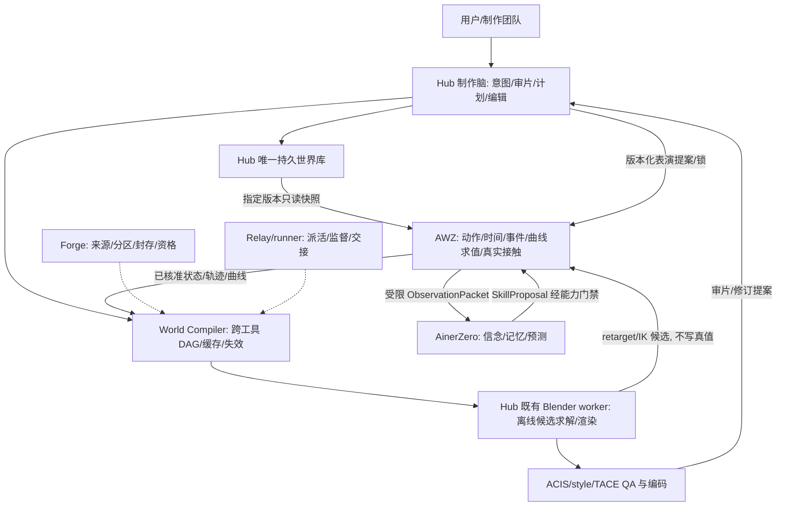

# Character First 制作能力升级候选方案

日期：2026-10-17；本地任务：`CF-DOC-20261017`；架构主责：Codex；文档执行：`proposal_writer`。
采用状态：**补充候选，待非作者审阅与主责决定；未发布、未替换主基线、未执行实现或运行。**
输入：用户附件《AnimeWorldZero v10 Character-First Architecture》；原件只读，内容不直接构成运行授权。
现行权威仍为 [V9-r5-20261016](/Users/mac/AinerWorkFlow/AinerZero/ARCHITECTURE_BASELINE.md) 及其 v10 工程验证层。
本地输入摘要、各仓 HEAD 和 dirty 清单见 [INPUT_MANIFEST.json](/Users/mac/AinerWorkFlow/AinerZero/reports/architecture-character-first-20261017/INPUT_MANIFEST.json)。

## 1. 结论与采用边界

建议吸收附件的 Character First、Open Source First、确定性先于神经增强、可编辑交付和跨工具编译方法，作为**世界系统制作能力升级**。
升级中心是角色能演、动作能编排、外观能稳定、结果可编辑；不以模块命名或短片存在代替自然度、表情、接触及编辑验收。
AinerZero 继续几何化结构状态、地图记忆与 H-JEPA 研究，保留旧 M2 记忆干扰常设对照，训练暂停；不承担 LLM 导演，也不成为生产前置。
三系统与唯一权威遵守 [ADR-0011/D-012](/Users/mac/AinerWorkFlow/AnimeWorldZero/docs/adr/ADR-0011-three-systems.md) 和 [ADR-0012 §5.4](/Users/mac/AinerWorkFlow/AnimeWorldZero/docs/adr/ADR-0012-v9-neurogeometry-hjepa.md:159)。
不新建可写世界库、身份系统、Blender 内部求值器或 Serafina 运行时。
所有任务在本稿只形成草案；已发布文档将 `awz.V9.A10` 记为 draft，原业务依赖及独立预算继续有效。
主责本轮 health 连接拒绝、Relay 重连读取失败：**实时卡面不可读**，不能把已发布状态说成已在线核验。

## 2. 已有设计、源码与运行证据分别看

| 对象 | 本轮实际看到的设计/源码 | 尚不能据此声称 |
|---|---|---|
| 主架构与队列 | 基线 r5、v10 验证层、A10 及原依赖已写入发布文档 | 当前所有子契约通过、代码总门已开或真实运行获批 |
| Hub 表演接口 | [performance_interface_v0](/Users/mac/AinerWorkFlow/AinerHub_IDEA/docs/v2/production_brain/performance_interface_v0.md) 有时钟、身份、分轨、锁和错误合同 | 文档中的无运行声明不等于源码完全空白；也不证明控制编译器已存在 |
| Hub CPU 校验器 | [performance_contract.py](/Users/mac/AinerWorkFlow/AinerHub_IDEA/code/apps/ainer-core/app/production/performance_contract.py:1) 已有纯函数语义检查，依显式能力表 fail-closed | 已生成曲线、接角色包、执行、渲染或跨仓 E2E |
| 动作合成原型 | [motion.py](/Users/mac/AinerWorkFlow/AinerHub_IDEA/code/apps/ainer-core/app/worldmodel/motion.py:204) 用毫秒闭区间并直接累加角度 | 已符合半开 tick、单一写者或通用 Motion Composer 合同 |
| Rig 原型 | [humanoid_rig.py](/Users/mac/AinerWorkFlow/AinerHub_IDEA/code/apps/ainer-core/app/director/blender_worker/loaders/humanoid_rig.py:120) 对标准 Mixamo 同名骨骼应用 rest-space 旋转 | 已有通用 BVH/FBX 重定向、IK、足锁或接触求解 |
| 编辑界面 | [Curves.tsx](/Users/mac/AinerWorkFlow/AinerHub_IDEA/code/apps/ainer-studio/src/stage/Curves.tsx:6) 为只读运镜曲线，[Timeline.tsx](/Users/mac/AinerWorkFlow/AinerHub_IDEA/code/apps/ainer-studio/src/box/Timeline.tsx:53) 是机位 key 选择/seek | 已有角色表演曲线编辑→提交→执行→回放闭环 |
| AWZ 渲染适配 | [blender_adapter.py](/Users/mac/AinerWorkFlow/AnimeWorldZero/python/animeworld/render_backend/blender_adapter.py:69) 明记尚未调用 Hub world_multicam | 已统一复用 Hub worker |
| EEVEE 切片 | [eevee_slice.py](/Users/mac/AinerWorkFlow/AnimeWorldZero/tools/blender/backend/eevee_slice.py:137) 导入 GLB 后清场，以球体代理检验投影结构 | 真实角色被消费、角色 NPR 或 ACIS 全通；历史结构探针不能升级为角色证据 |
| 角色包 v2 | [CHARACTER_PACKAGE_V2.md](/Users/mac/AinerWorkFlow/AnimeWorldZero/docs/design/CHARACTER_PACKAGE_V2.md:1) 是未采用设计候选，引用原 identity v1 | 控制器命名已登记为 executable 或现有角色已支持全部 AU/手势 |
| 后端通道 | [backend_capabilities.v1.json](/Users/mac/AinerWorkFlow/AnimeWorldZero/contracts/backend_capabilities.v1.json) 对 Blender line/normal/motion 保守标未支持 | 一次旁路输出 normal 就完成正式能力升级；骨骼轨迹等于运动矢量 |
| 身份核 | [session.py](/Users/mac/AinerWorkFlow/AnimeWorldZero/tools/gate_id/ccip/session.py:53) 的真实 CCIP 入口恒抛 RealSessionBlocked | CPUFakeSession 是真实身份评分或旧 Godot 结果证明 Blender 身份通过 |
| 编码与声音 | [export_cli.py](/Users/mac/AinerWorkFlow/AnimeWorldZero/tools/world_player/export_cli.py:132) 使用 libx264 且 -an | 硬件编码、带声音成片或音画同步已经完成 |
| 白模对白旁路 | [dialogue_route.py](/Users/mac/AinerWorkFlow/AinerHub_IDEA/code/apps/ainer-core/app/worldmodel/dialogue_route.py:33) 有 Rhubarb 贴片/FFmpeg，retime_voice 改语速和留白 | 已满足锁定音频身份；旁路能静默改变定稿声音 |

本轮仅阅读与摘要取样，没有重跑上述历史证据，也没有运行 CPU 测试、Blender、真实 CCIP、模型或编码。
源码存在证明可复用入口；设计通过、消费者集成、实际资产加载、真实运行和视觉验收必须分别交证据。
现有工作区有他人未提交修改，HEAD 只标提交基点；本稿对应的已查文件身份以指定文件 SHA256 为准。

## 3. 职责与数据流

Hub 管制作意图、审片、制作计划与编辑，并唯一写持久世界；AWZ 管运行时的动作、时间、事件、确定性求值和真实接触。
Hub worker 只消费 AWZ 核准的状态/曲线产物；离线 retarget/IK 只产候选，须经 AWZ 校验采用才成为运行结果。
角色身份、ACIS/style 及控制权沿 AWZ 合同；Hub 用精确引用，不能通过编辑器或 worker 绕过世界版本和用户锁。
World Compiler 是这条链的编排与派生物，不取得持久世界、运行状态或研究资格的写权。

## 4. 附件逐项吸收与纠偏

| 附件提议 | 吸收落点 | 必要修订 |
|---|---|---|
| CPE | Hub performance_interface_v0 + CPU 校验器 + AWZ PERFORMANCE/角色包 v2 | 是已有谱系的执行补齐；不另起平行表演接口 |
| ACC | AWZ 运行求值；Hub 计划/编辑；worker 离线候选 | 补 BeatGraph、根轨迹、接触计划、共享节拍及最终校验；不把现有角度相加当完成 |
| TACE | ACIS/style/CCIP + 角色包精确身份与 QA | 第一阶段即做基础身份稳定；跨镜头 QA 后续扩充，不建立第二身份系统 |
| World Compiler | Hub 计划→AWZ 校验→Hub worker 的跨工具 DAG | 不复制 Blender depsgraph，不新建可写 ECS/持久库 |
| Serafina→AinerZero→生产串联 | 现有 Relay/runner 管任务，AinerZero 为可选提案者 | 去掉世界脑作为所有生产的必经前置 |
| World IR v10 | 最小 Production/World IR 派生编译产物 | 不覆盖 E3/A2，不把建议 YAML 或 float 秒写成新权威合同 |
| 开源物理 worker | 一个权威求解域的可替换后端 | Blender 与外部 Bullet 不得在同一时间区间双写 |
| 所有通道/确定性标记 | 读取实测能力与登记域，缺通道明确 unsupported | deterministic:true 不是跨后端逐位保证；图像用既有容差 |
| 神经时序增强 | 可选、默认关闭的未来候选 | ADR-0007 当前禁历史依赖；另起 ADR/回放协议后才可研究 |
| 15 秒“商业”基准 | 可编辑表演、接触、外观与成本的验收题 | 题目不是质量承诺；自然度/美术须实测人工与数值门 |
| REA | 只有具体、已复现缺口才起有预算旁路 | 闭源 Maya/Houdini/AE 等保留未来研究，本轮无调用 |
| 首个候选校准阈值 | 先预登记数值/人工门及固定正负例 | 不根据首个候选输出事后放宽；开发调参与独立验收分离 |

Blender 已有内部依赖图，外层只编排跨工具任务、缓存与失效边界，依据 [官方 depsgraph 文档](https://developer.blender.org/docs/features/core/depsgraph/)。
动作库、IK 与固定几何是可控基础，不自动带来自然表演或商业美术；每层仍须真实角色与实际消费者验证。

## 5. 关键合同与失效规则

### 5.1 最小 Production/World IR

最小派生项：制作计划身份/版本 + world_snapshot_ref + performance/action refs + render job + 编译器/适配器版本和依赖清单。
保持 E3 的 world_version / scene_id / scene_revision / snapshot_digest / source_digest 五元组；A2 的快照、受限观察与时间白名单原样生效。
持久世界、运行事件/快照、表演提案和渲染产物各自版本化；派生 IR 不替代事务信封，也不把编译缓存变成世界源。
任一消费者须解析精确引用并核对内容身份、版本、单位/坐标、锁、来源与实际支持能力，不能只检查 JSON 形状。
已准入工件、内容身份与来源资格分开；同一 blob 可复用字节，不共享分区、许可、训练资格或不可见数据权限。

### 5.2 表演、时钟与控制权

以 120Hz tick、左闭右开区间为内部锚点；24fps 时每帧 5tick，15 秒为 1800tick/360 帧。
输出 fps 与采样率显式声明并沿现行换算合同；非整数映射保留有理数，不用 float 秒或任意 fps 重定义运行时间。
音频沿原字节 digest、sample_rate、anchor_tick、offset_samples 与可信对齐身份；取样边界未实现就报告缺口。
情绪、mouth、gaze、body、hands、voice 分轨同步；情绪不能被嘴型覆盖，口型不反向静默改音频。
无真实音频/可信 aligned 产物则 mouth unsupported；定稿前变速/加留白须产新音频版本并重新对齐、定稿。
同一 actor、实际部位/别名、半开区间只有一名有效写者；用户锁和已执行历史不能被候选改写。
现行 v0 无 priority/blend weight 字段，同优先级重叠即冲突；只接受已登记单一 blend owner 与规则，缺规则拒绝。
若要优先级或权重，先升合同并给迁移与非作者复核；不得在 adapter 中假造已有参数。
角色包的 pending/unsupported 控制器不变成 executable；能力登记与实际资产绑定、执行证据逐项独立核对。

### 5.3 动作、接触与单一物理权威

ACC 链：ActionIntent→BeatGraph→资产候选→根轨迹/接触计划→retarget/composer→约束/IK→风格化/时间重映射→最终校验。
风格化和时间重映射可再次破坏接触，因此最后必须重验接触、碰撞、足滑、连续性和轨道时钟，合格后才可采用。
计划接触、实际发生事件、表现效果分别记录；艺术夸张需明确 mechanism/作用域，不能假造真实接触或训练标签。
双人共享节拍、接触点及双方约束由编排层协调；分别检索/生成单人片段，不把两个独立候选拼接当互动完成。
首版在 AWZ 固定时间规范内采用一个权威求解域，封存求解配置并烘焙轨迹；外部求解器只供候选或被选定为该域后端。
世界/事件只在既有登记确定性域验证；图像沿既有容差；跨版本/后端不承诺逐位一致。
依赖历史的模拟若采用，须另有检查点、可回放、随机访问与状态恢复协议，不能让渲染调用隐式重模拟。

### 5.4 内容缓存与局部重算

首个竖切之前就固定最小缓存身份；正确性通过后再做完整优化，计时包含编译、查验、IO、失效传播与回退成本。
缓存键至少绑定：E3 身份、动作/rig/曲线/依赖摘要、适配器/算法版本、seed、时间域与输出区间。
物理另绑定：权威求解域、步长、求解顺序、边界条件和暖启动状态/有效检查点身份。
渲染另绑定：后端/引擎版本、色彩管理、材质/灯光/相机、采样/输出设置、角色与风格引用。
缓存命中仍重验锁、版本、来源/分区和能力；命中不能授训练资格，也不能绕过被撤回资产或失效来源。
早期物理/动作改变，沿后续接触与约束依赖闭包传播；无有效检查点则重算整段，不以局部 dirty 猜安全边界。
仅相机改变通常只重渲染；嘴型仅在不驱动碰撞、注视或其他轨道时局部重算，否则传播相应依赖。
材质/道具变化依具体依赖传播；不承诺物体级局部渲染必成立，无法证明则安全扩大重算范围并报告原因。
随机访问与顺序输出必须对照；[ADR-0007](/Users/mac/AinerWorkFlow/AnimeWorldZero/docs/adr/ADR-0007-render-determinism.md) 当前禁止依赖历史帧的效果，首版渲染不引入此依赖。

### 5.5 能力登记、来源与观察隔离

[研究 adapter_registry](/Users/mac/AinerWorkFlow/AinerZero/docs/research/adapter_registry.json) 是研究目录，不是执行能力表、运行授权或许可授予。
运行能力沿 AWZ backend_capabilities + [render_backend 合同](/Users/mac/AinerWorkFlow/AnimeWorldZero/contracts/render_backend.v1.schema.json) 小范围扩展，逐项保留许可、资产授权和训练来源政策。
TACE 按实际可用通道降级并标记缺口；required 通道不可用则拒绝，不以 canny/骨骼投影冒充 line/motion 正式通道。
TACE 复用 ACIS 身份、固定几何/材质、角色版本、跨帧/跨镜头 QA；真实 CCIP 未接通时明确身份评分未验证。
AinerZero 只读允许 Observation；CPE/ACC 真值 ID、隐藏接触、完整编译缓存、封存 QA/反例标签均不得进入学习侧。
AWZ 来源仍 external_derived 默认不可训练；将来动作/表情专项训练另立数据、预算与授权，不能借本方案恢复 AinerZero 训练。

## 6. 分阶段与本地任务草案

以下 `CF-*` 仅为本地候选号，**未创建为 Relay 卡、未领取实现、未下发运行**；每个实现草案配不同作者的验证草案。
发布文档所列 A10、E3、A2、Event 补修、角色/风格、生产计划及各卡原依赖全部保留，不能用一张总门替代。

| 阶段 | 本地候选实现/设计 → 非作者验证 | 最小交付及停点 |
|---|---|---|
| 0 契约与消费者映射 | CF-C01 → CF-V01 | 对照现有字段/加载器/worker/UI，定身份、时钟、单写者、来源与回滚；补缺合同先审，不执行 |
| 1 编译竖切与一人合同 | CF-C02 → CF-V02 | 最小 DAG/缓存身份/IR 适配设计；真实角色消费者与统一 Hub worker 路径；TACE 基础身份从此开始 |
| 2 同批 P0 多轨表演 | CF-C03 → CF-V03 | Body+Face/Gaze/Hands/Voice 同批与基础 ACIS；10 秒有情绪、注视、手势、台词的表演，不止走路 |
| 3 接触与双人编排 | CF-C04 → CF-V04 | BeatGraph/根轨迹/共享节拍/接触与最终风格化后校验；单一物理域、候选采纳闭环 |
| 4 跨镜头 QA 与完整基准 | CF-C05 → CF-V05 | 15 秒庭院动作+面部近景，480p/24fps/360 帧；身份/时序/编辑/声音/成本/随机访问独立验收 |
| 5 可选增强与 REA | CF-C06 → CF-V06 | 只有可复现缺口和预算时研究神经/REA；可停、可回退，关闭不阻断生产 |

CF-C01/V01 首先厘清 motion.py 闭区间与叠加、控制器注册、单位坐标、world/performance/presentation 归属及所有消费者。
CF-C02/V02 先证明真实角色及核准曲线确实进入统一 worker，不能用代理球或只通过 schema 替代。
CF-C03/V03 需有角色曲线编辑→版本提交→锁检查→AWZ 求值→worker 消费→回放证据；机位曲线 UI 不能顶替。
CF-C04/V04 在正确性稳定后才扩展动作缓存、检查点与性能；不把快速结果当允许改接触/时钟门的理由。
CF-C05/V05 的 15 秒是可复用验收题，不承诺商业成片；失败可停在前一已验证阶段，原素材与失败保留。
每阶段实现前由统筹指定文件负责人、允许修改范围和非作者验证者，按现有规则登记独立运行预算。

## 7. 验收设计与正负例

数值门、人工量表、固定正负例、样本/分区和输出身份须在候选运行前预登记；缺门就写未验证，不临场发明通过线。
人工评价至少覆盖表演意图可读、情绪/眼神可信、动作自然、接触与节奏可信、镜头连续、可编辑；不能只评“画面漂亮”。
数值至少记录接触误差/足滑、关节连续性、穿模、嘴型对齐、身份/调色板/轮廓时序、缓存失效和全成本。

| 固定正例 | 已知坏对照，必须被发现或拒绝 |
|---|---|
| 已登记 rig/控制器/单位、合法轨道 | 错骨骼映射、超域值、占位控制器冒充可执行 |
| 分轨情绪与可信音频 mouth | 嘴型覆盖面部情绪、错音频 digest、错 sample 时钟、改锁定音频 |
| 单一写者及不重叠半开边界 | 别名重复写者、锁冲突、相邻闭区间双生效、改已执行历史 |
| 真实角色与精确身份引用 | 交换角色身份/网格、球体代理冒充角色、CPUFakeSession 冒充真实评分 |
| 核准接触与最终风格化后校验 | 接触时序错误、删除接触修正、重定时后足滑/穿模 |
| 支持通道与明确降级 | 请求不支持的渲染通道、把骨骼轨迹当运动矢量 |
| 正确失效及有效检查点恢复 | 过期缓存、换 seed/后端/物理步长仍命中、早期接触变更未传播 |
| 顺序/随机访问及编辑后回放 | 历史帧依赖、暖启动状态缺失、编辑后只改视频而曲线不变 |

非作者用冻结输入重新采集实际输出并保留坏结果；文档/schema、CPU 消费者、真实资产/运行、视觉/能力分层报告。
不能以旧截图、旧 CPU 重算、作者退出码或 MP4 存在代替当前真实消费者、身份、接触和可编辑证明。
各阶段报告实际命令、源码/资产/配置/检查点摘要、预留与实际预算、失败、未验证项；completed 与能力通过分别写。

## 8. 外部能力候选与部署边界

成熟 Blender/FFmpeg/现有动作资产先行；OpenUSD/SciPy/Bullet 等只在明确接口和已证实缺口处小范围适配，不先搭大型插件市场。
[HY-Motion 官方 README](https://github.com/Tencent-Hunyuan/HY-Motion-1.0) 提供 macOS 路线；Lite 0.46B 最低 24GB 是官方 VRAM 表，不是本机统一内存峰值。
官方限制含多人交互、环境/相机控制与复杂情绪，故仅作 P2 单人动作候选；不假设 MLX 原生或本机性能，不阻塞动作库路线。
[Audio2Face-3D SDK 官方 README](https://github.com/NVIDIA/Audio2Face-3D-SDK) 当前列 Windows/Linux、NVIDIA CUDA 12.8+；不假设 Mac 直接运行，列 P2 非阻塞候选。
上述线上事实由主责本轮查官方来源；本执行者未安装、下载或运行，许可/权重/资产准入仍逐项按现有政策审查。
REA 只有复现案例、参考输出、缺口/瓶颈、明确预算、停止条件和独立适配接口齐备才形成新研究任务；本轮没有 REA 调用。
重型阶段按资源守卫串行，先低分辨率验证；模型推理、渲染、增强和训练不因 96GB 内存而免预算或允许并行争抢资源。

## 9. 迁移、回滚与本轮交付

阶段适配器可逆、feature flag 默认关闭；旧合同、角色/风格版本、金样、原失败和源报告原样保留。
新提案先 preview/validate，再经现有变更信封采用；失败退回旧不可变引用，不删除候选或重写旧 take。
改变权威写者、公共语义、来源资格、观察可见性、科学门或预算时另立 ADR/迁移/回滚，经非作者复核后才能发布新修订。
本轮只生成本目录 CLAIM、PROPOSAL、INPUT_MANIFEST；根架构/冻结基线/任务与日志、产品代码、附件 Library 均未修改。
清单是逐文件读取时的身份取样，非共享工作区原子快照；发生后续改动时应针对实际消费者重新冻结输入。
五仓均记录身份查询；AinerForge 目录没有可解析 Git HEAD，按查询失败如实保留，不补造提交身份。
文档整理不创建新的运行或预算登记，也不消耗已有实验 ID 的剩余额度。
本稿待 `character_inventory` 非作者审阅及 Codex 最终审议；没有将本方案标成已采用、已实现、已通过视觉门或生产验证。
