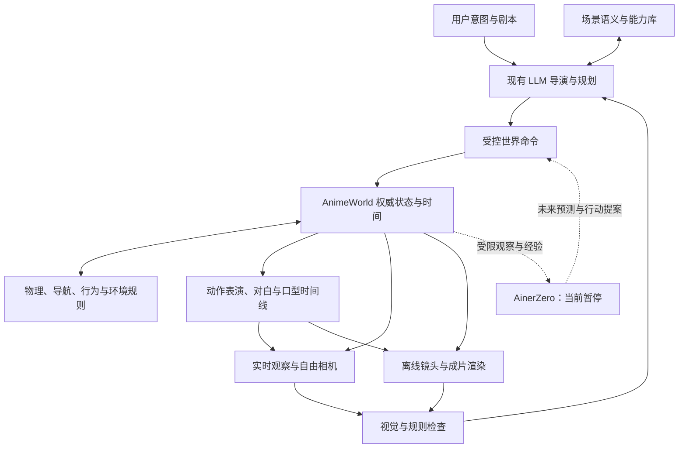

# 第二次审议：AnimeWorld 自身的世界规律与交互运行职责

日期：2026-10-15（Europe/Istanbul）；主责：Codex。  
依据：用户在首轮审议后补充的长期目标与疑问。性质：架构建议，未修改已接受 ADR，未恢复暂停任务、训练或渲染。

## 1. 修正首轮审议的侧重点

首轮着重补“文本到可编辑短片”的制作闭环。本次补充更基础的要求：**AnimeWorld 必须能独立运行一个有规则、有语义、有角色行为的世界，制作链和实时观察都从这个世界取数据。**

“世界脑学习规律”和“世界系统执行规律”是两件事。AinerZero 暂停，不应使 AnimeWorld 失去碰撞、导航、光照、接触、可见性或行为控制。现成 LLM、规则、规划器、物理/渲染计算和视觉评价可以先组成 AnimeWorld 的生产智能；自有神经世界脑是未来可接入的另一种能力来源。

## 2. 本次只读核对到的事实

- `AnimeWorldZero/python/animeworld/kernel/state_log.py` 的 WorldKernel 可以登记实体，按时间求解既定 locomotion，并生成状态日志。
- `kernel/collision.py` 主要检查预编轨迹是否接触实体/障碍；它不是已实现的完整接触动力学求解和即时避障系统。
- `kernel/environment/cloud.py`、`ripple.py` 等已有风、云、因果水波规则。因此“AnimeWorld 完全没有物理规律”不成立。
- `docs/spec/AnimeWorld_Zero_v8.0.md` §3.1 已设计 World Rules、Simulation Coordinator、World Query、Constraint Validator；§7 已设计动作规划、导航和物理/艺术化运动。这些职责并非原始愿景完全漏掉。
- `docs/adr/ADR-0010-v8-alignment.md` §6 将近期实现收窄为“改世界源后重新编译时间线”；有内部状态的积分器留待后续 ADR。这适合当前可复现制作切片，不能据此宣称任意实时交互已经可用。
- 本次未运行仿真、渲染或性能测试；源码性质、规划归属和实际实时表现分别判断。

## 3. 三类能力的所有权

| 类型 | AnimeWorld 的职责 | AinerZero 的未来学习职责 |
|---|---|---|
| 物理/时空 | 明确规则、状态、接触、动力学、时间推进、可控干预与事件记录 | 从受限观察学习状态表示、预测、因果与规划 |
| 视觉/光照 | 明确几何、材质、光源、相机；计算遮挡/投影/阴影；声明渲染近似和美术覆盖 | 从画面推断对象、空间和光照，预测视角/动作变化后的观察 |
| 语义/行为 | 记录对象用途、可交互点、动作前提/效果、角色目标与关系；提供查询、规划和执行接口 | 学习可迁移的关系、行为效果和主动策略 |
| 美术/制作 | 风格规则、表演、镜头、音频/口型、画面评价和有界参数改进 | 在独立登记的任务中学习；不自动继承生产系统的工具或评价能力 |

这些是系统责任，不意味着都必须自行训练模型、全部写成 Python，或重新开发通用物理与图形引擎。

## 4. 建议的最小完整架构

其中缺失的关键职责应明确落入现有模块，而非再建一个含糊的“万能 Brain”：

1. **世界规则与仿真**（1.1）：重力、接触、支撑、穿透限制、天气、光源状态、物理/小说规则及规则版本。
2. **交互运行与行为控制**（1.1/1.3）：接纳当前时刻的动作命令，校验可达性、推进状态、记录事件；主要角色与群体行为分层。
3. **场景语义与动作能力**（1.2/1.6）：门能否打开、椅子在哪坐、台阶能否上、物体能否拿、动作需要什么、结果是什么。让 LLM 可以查询、试演、发现失败，再修订计划。
4. **视觉规律与制作检查**（1.5/1.8/3.6）：区分物理正确、画面可读、动漫审美；将发现转为可定位的世界/风格/镜头修改。

建议在模块树现有父项下登记清楚责任和进入门；具体永久编号由当前模块表负责人分配，不在本稿抢占编号。

## 5. 不同引擎只用一份世界结果

推荐保留实时观察与离线制作两类消费端；它们不各自拥有一套互不一致的世界物理。权威状态、身份、动作事件和时间统一由世界核心管理。需要数值物理时，可以选成熟求解器作为受控适配器，让核心接纳和记录其结果。

“Python 是真值权威”应落实为明确的数据所有权和提交规则，不应演变成所有复杂物理都只能自己写解析公式。若引入有状态求解器，需要按仓库规则补 ADR、快照、随机性和回放容差，保留现有时间线切片。

两种运行方式共用语义与状态契约：

- **编排回放**：先规划动作，生成轨迹/事件，再从任意镜头重拍；当前优先的制作方式继续有效。
- **交互运行**：当前动作改变后续状态，产生事件和新快照；录制这次运行后，离线仍可从记录回放。自由视角可以先消费既定回放，随后逐步增加真正的交互。

实时后端是否选 Godot、何时恢复既有挂起任务，是后续具体实施决定。本次不以用户对架构的疑问推断其已经选择 B 或批准恢复全部 Godot 线。

## 6. 对用户提供的 A/B/C 解释的进一步修正

- “实时是最终核心体验”和“本轮先完成 Blender 切片”可以同时成立；一个是产品能力定位，一个是交付顺序，不能只因近期后置就认定架构冲突。
- 同一世界便于保持角色资产身份，但身份锁本身不能保证错误绑定、神经精修、服装变化或任意视角下的视觉表现全都正确。
- 自由相机不等于任意机位都有优质动漫构图。依赖固定镜头的脸部形变、薄片布景与光影修饰，需要多视角和全景验证。
- 数千/上万角色应拆成“登记的角色总量、当前活跃角色、同屏角色、近景高质量角色、同时执行复杂决策的角色”。各自预算和测试，不能用一个人数承诺吞吐量。
- 全景视频允许在预先拍摄的空间位置转头看；允许观众自由移动、产生正确视差，需要额外的三维交互或相应表示。普通全景出片与六自由度 VR 是不同验收目标。
- “LLM 独立驱动”表示无需 AinerZero 也能完成任务；仍需要语音、动作、导航、世界规则、渲染和质量检查等工具执行。LLM 不负责逐帧计算所有对象。
- 复用可以降低新镜头成本，但声音、表演、换机位、加载和画质仍有代价。没有本机同负载测量前，不保证实时或电影制作“很容易”。

## 7. 更能检验目标的近期场景

建议把首个可复现短片发展为一个很小但真正可交互的场景：一间房或一小段街道，一个角色，一扇门、一把椅子、一盏灯。

| 测试 | 世界系统应完成 | 可证明的范围 |
|---|---|---|
| 让角色绕障碍走到椅子并坐下 | 查询目标和坐点、校验路径/接触、执行动作、记录坐下事件 | 有最小语义、行为和世界反馈 |
| 临时改变门的开闭状态 | 后续可达性和角色计划相应改变 | 有当前命令影响未来的交互，而非只切换回放镜头 |
| 移动一盏灯 | 物理光源状态改变，阴影/高光按所选渲染模型响应；美术覆盖有标注 | 世界光照与图像有可追溯关系 |
| 同一时刻切三个机位 | 实体、动作、道具和事件不变；各机位画面重新生成 | 一次运行、多次取景 |
| 角色说一句话 | 主音频、表演、口型和事件时码关联 | 最小声画表演链 |
| 存档、重开和重拍 | 身份、规则、状态和声音时间线恢复 | 持久世界与制作复用 |

先固定一个小场景、规则范围和任务预算；每项分别报告成立/不成立/未验证。群体、全景和长篇小说在这一小场景后扩展，避免用规模演示掩盖规则与反馈仍未接通。

本稿新增的是规划职责与验收建议，不是实现完成声明。本次无实验、模型、渲染、训练、派发或部署。
