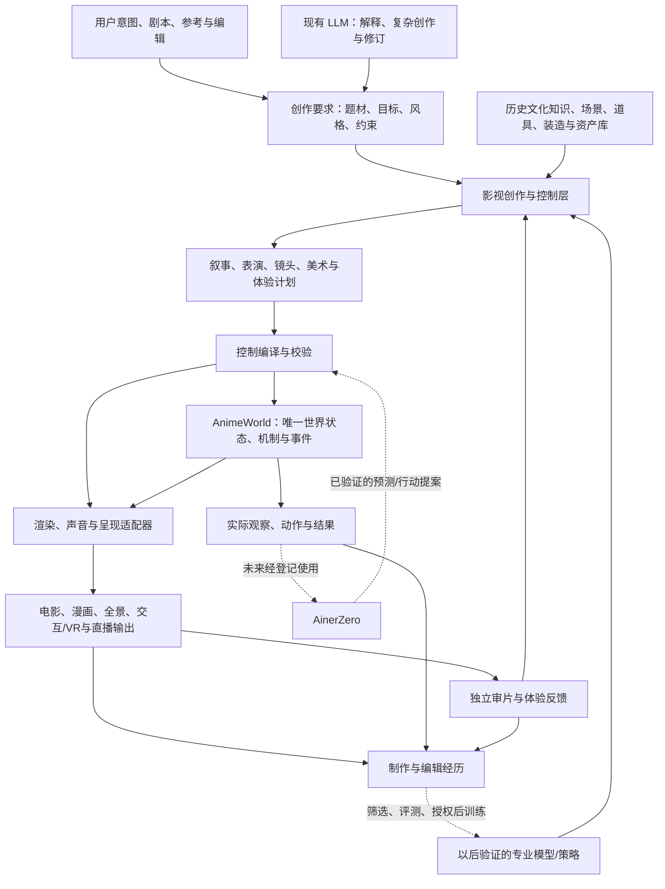

# 影视创作与控制层：独立于世界运行和 AinerZero 的架构提案

日期：2026-10-15（Europe/Istanbul）；主责：Codex。  
性质：用户需求驱动的顶层架构审议。只新增本目录中的提案和来源清单；没有修改正式 ADR、根目录任务、模型或运行登记。

本文吸收 R1–R4，集中回答：是否增加类似专业影视团队的独立智能层；是否立即训练一个覆盖全部岗位的小模型；怎样控制世界、逐镜编辑、审片、全景/VR与直播，以及未来 AinerZero 的位置。

## 1. 明确建议

**应当把“影视创作与控制”单列成可独立演进的能力层；先以现有 LLM、知识/资产库、可执行工具、结构化计划和评价闭环实现，再依据实际数据训练专业策略。**

不建议把“先训练一个全岗位小模型”设成近期制作的前提。目前没有本项目证据支持一个小模型同时达到历史知识、复杂编剧、空间规划、多模态审美、摄影、表演与实时控制的全部要求。模型大小、是否多专家、是否使用 LoRA，要由任务、数据与实测决定。

这次需要调整的是顶层职责和控制协议。既有世界内核、身份/资产、场景协议、渲染、任务平台和证据不重建、不搬移。

## 2. 三个系统与共享底座

| 系统 | 核心责任 | 交付/接口 |
|---|---|---|
| 影视创作与控制 | 从意图到剧本、叙事、表演、美术、镜头和体验；提出修改并评价作品 | 制作计划、控制提案、审片问题与修订 |
| AnimeWorld 世界运行 | 维持世界/人物/形态/机制/时间/事件，执行经过校验的行动；支持记录和重放 | 可查询/可编辑/可执行的世界与实际反馈 |
| AinerZero | 独立学习、预测与决策；未来按已验证技能接入世界或生产任务 | 受限观察、预测/行动提案及对应能力证据 |

共享底座：知识与资产、风格与形态版本、渲染后端、音频、经历与 Forge、资源/任务监督和独立验证。

这里“影视创作系统独立”首先是逻辑与接口独立，不等于现在新增仓库或十几个微服务。归属应与现有 AinerHub/Studio 的 Creative Brain、Director 和 AWZ 编译器协商；本次不修改关联仓库。

风格/色彩、拍摄意图与世界因果分开。物体的物理材质、世界光源可以属于世界；色彩脚本、镜头补光、风格化阴影和调色属于明确的制作覆盖，不能暗改真实身体或伪装成物理真值。

## 3. 完整工作流

现成 LLM 不必永远只做“解析一下”。它可以继续承担复杂剧本理解、创意与异常修复；专业模型逐步承接范围稳定、证据充分、值得降低成本/延迟的任务。

## 4. 影视团队的岗位是技能分工，不是一岗必须一个模型

| 技能组 | 输入 | 输出 |
|---|---|---|
| 剧本/叙事 | 原文、人物目标、题材和前文状态 | 场景、冲突、节拍、信息揭示、可分支事件 |
| 导演/场面调度 | 叙事目标、世界可用能力、角色状态 | 人物走位、注意力、表演任务、节奏与拍摄意图 |
| 美术/装造/道具 | 年代地域、项目美术规范、角色与预算 | 场景/服饰/道具/材质/色板/灯光配方及资产引用 |
| 摄影/剪辑 | 表演、声音、镜头目的、呈现模式 | 景别、构图、焦距、机位轨迹、切点与连续性计划 |
| 表演/声音 | 角色目标、身体/能力、实际音频 | 动作、表情、注视、接触、对白轮次与口型轨 |
| 沉浸/交互叙事 | 观众位置、观看/交互记录、故事状态 | 触发、延迟/分支、角色响应、注意力引导与体验过渡 |
| 监工/审片 | 制作要求、规则、作品/通道与执行日志 | 有出处的问题、维度评分、修改建议和未验证项 |

可以先用同一现有模型配不同任务上下文完成多个岗位，调度与记录仍分开。也可以由规则、优化器、检索或专门小网络完成部分岗位。不能仅靠多个“角色提示词”就认定形成了有验证能力的专业团队。

## 5. 大集合应分别放在知识、资产、技能与权重中

| 内容 | 推荐存放方式 | 原因 |
|---|---|---|
| 历史/年代/地域资料、文化与服饰依据 | 可检索知识库，带出处、适用范围与不确定性 | 可更新、可纠错，避免把架空补全冒充历史事实 |
| 角色、衣服、道具、建筑、材质、动作 | 有版本的资产和参数化生成器 | 能真正被世界和渲染执行，保持一致性 |
| 摄影范式、表演模式、类型叙事经验 | 结构化技能/样例与适用条件 | 支持检索、组合、参数编辑与实际验证 |
| 镜头/构图选择、局部修正、偏好和连续性判断 | 经验证后考虑训练策略/评价模型 | 任务范围更明确，可与无训练基线比较 |
| 跨岗位语义和复杂创作 | 先复用现成模型；以后依据数据调整 | 不把广泛知识与创作能力从零训练当作第一阶段前置 |

时代、类型、风格、世界机制、身体能力继续按 R3 分开。可以构造“某年代外观的架空都市＋未来义体＋魔法”，但要记录它的架空性质和机制边界。

一个可研究的后续方案是共享基础模型、岗位条件或专业适配器，以及外部库和执行器。原始 [LoRA](https://arxiv.org/abs/2106.09685) 是在兼容模型上训练低秩更新的方法；这不证明任意多个适配器能无损混合，也不自动提供美术或导演能力。是否采用要单独测量收益与回归。

## 6. “世界的 ControlNet”可以作为比喻，技术上需要语义控制协议

[ControlNet](https://arxiv.org/abs/2302.05543) 原本针对预训练图像扩散模型增加空间条件。这里的控制对象还包括角色意图、事件、身体、声音、镜头、交互和世界修订，因此应实现可编辑的多层计划与执行接口，而不是直接把现有 ControlNet 挂到世界引擎。

最小控制内容建议如下；名称是提案，不表示已有 schema：

| 控制记录 | 关键内容 |
|---|---|
| 创作要求 | 原文/用户意图、题材混合、情绪目标、观众与标准、世界/时代、限制和预算 |
| 叙事计划 | 人物目标、冲突、节拍前提/结果、信息对谁可知、分支与失败路径 |
| 世界计划 | 实体/资产/形态、机制与文明、空间关系、规则作用域和世界 revision |
| 表演计划 | 谁做什么、动作/身体能力、道具接触、表情/注视、声音与时序 |
| 镜头计划 | 镜头 ID、所服务节拍、景别/主体/目的、相机与镜头参数、约束与切点 |
| 美术计划 | 风格/材质/装造/色彩脚本、灯光/后期、允许覆盖和兼容范围 |
| 体验计划 | 电影/全景/交互/VR模式、观众角色、镜头接管权限、注意力和触发规则 |
| 执行与反馈 | 实际采用的命令、结果、失败、资产/源码身份、作品和审片引用 |

控制编译器把高层要求映射到实际存在的动作、资产、生成器和后端能力。缺能力就报告未支持或提出可审阅的替代，不能在输出里把未知动作写成成功。

语言计划需受到具体能力约束，这与 [SayCan](https://arxiv.org/abs/2204.01691) 将语言规划和可执行技能结合的分工有参考关系；该研究不证明这里的电影制作系统已经实现。

### 不同层的控制权限

- 改镜头/剪辑：改变呈现计划，不自动改变世界里已经发生的事件。
- 改表演：产生新表演 take 或影响尚未执行的行动；角色状态/事件相应更新。
- 改世界：通过世界命令和新 revision，保留旧状态与依赖。
- 改风格：更新明确的美术覆盖；若需要改真实身体或能力，必须走相应世界/形态变更。
- 用户锁定字段优先保留；模型不能为了提分悄悄移动主角、换脸、改台词或放宽约束。

## 7. 逐镜编辑与自动导演并存

同一份结构化制作计划同时接受三种输入：

1. 简单创作要求：系统补齐候选镜头、资产与表演。
2. 详细自然语言：指定某镜头景别、色彩、反应、节奏与禁止改动项。
3. 既有编辑器中的时间线/空间操作：拖相机、改焦距、移道具、改镜头时长、锁角色或调整动作。

每次修改有明确范围、基础 revision、依赖和可撤销记录。世界运行、镜头、美术与音频不各存一套互不一致的事实。复用现有 Studio/Director/场景协议的入口，不新建重复的视频 UI。

例如用户修改“保留对白和站位，把这一镜改成更压迫的悬疑中景”：系统应识别被锁项，提出构图/相机/光照候选，先渲染预览，再按固定标准评价；不通过偷偷改对白或剧情来凑效果。

“悬疑”“喜剧”要转成叙事与表现目标：悬疑可涉及信息差、延迟揭示、声音预兆；喜剧可涉及预期与反转、表演停顿和人物反应。这些是候选手法，不是观众必然紧张或发笑的公式。

同一世界可以制作不同题材版本；若反应、声音或事件节奏改变，记录为新表演/制作版本，不把它们伪称为同一个 take。

## 8. 打分、审题与监工

建议将标准拆成以下维度，并记录标准版本、适用作品/镜头和证据：

| 维度 | 检查例子 | 判断边界 |
|---|---|---|
| 意图与题材 | 是否回应剧本、题材目标与信息揭示计划 | 不能单凭一张截图证明整部作品题材成立 |
| 年代/世界设定 | 道具、服饰、建筑、技术和角色知识是否符合选定世界 | 架空设定与历史资料分别判断 |
| 剧情与人物 | 因果、动机、关系、秘密和反应是否连续 | 自然语言评分不等于客观真值 |
| 摄影与剪辑 | 主体可读、视线/动作连续、镜头目的、节奏与切点 | 艺术性破例可有意图，不能机械惩罚所有破例 |
| 美术与身份 | 形态、装造、材质、色板、跨镜头一致性 | 预期变形与意外漂移分别判断 |
| 声音与表演 | 对白可懂、角色音色、口型、情绪、接触和反应时序 | 动漫与写实使用各自适合的评价配置 |
| 执行与体验 | 命令成功、重放、编辑、交互、实时延迟和资源 | 未实际执行/测量的项目不能写通过 |

硬约束是执行/身份/锁定要求/已登记规则等；美术和类型效果通常是可比较的目标。缺标准或缺证据时写“未验证/需复核”，不捏造确定分数。

创作者自评可指导有界搜索，专业达标和能力晋升需要独立评价。不能让同一作者只靠自己的分数训练、挑选并宣布专业级。保留基线、所有候选、失败、评价器身份、用户修订与实际成本，防止评分器变化制造虚假进步。

## 9. 全景、交互叙事与直播的共同底座

共用世界、角色、事件、声音和叙事意图；按模式分别编译呈现与参与策略。

| 模式 | 控制方式 |
|---|---|
| 传统电影 | 摄影/剪辑决定画框、机位、切换和固定作品时间线 |
| 全景电影 | 观众转头观看；导演以场面、方向性声音、光线和事件节奏引导注意力 |
| 互动叙事/VR | 观众行动改变条件和后续事件；角色感知与叙事控制器共同响应 |
| 实时直播 | 导播对未来可执行时间段发送指令，世界持续运行，呈现/音频/编码/传输持续输出 |

全景/VR改造不能只把普通相机换成360相机。原本靠特写、反打、剪辑隐藏的信息，需要重新安排在空间、声音、走位与事件中。VR的视角归属和过渡模式独立声明，不默认强制用户转头。

同一实际录制可以被多次取景；观众介入改变事件后产生新会话/分支。多人共享世界还要分别记录各观众的位置、行动和已呈现信息，不能把某个人看到的线索自动写成所有人都知道。

### 直播应提前设计的执行语义

- 指令有目标实体/字段、基础 revision、最早生效时间、截止、取消和优先级。
- 每个控制范围只有一个生效写入者，处理导演、角色策略、用户和紧急规则之间的冲突。
- 模型异步规划未来行动；本地运行时持续推进动作、口型、物理和渲染，过期计划拒绝。
- 区分规划时延、场景/资产准备、动作/音频、渲染、编码、网络与终端延迟，并记录整条链路。
- 模型或网络暂时慢时有明确的既有计划、待机、备用镜头/音频等降级方式；不得为了低延迟悄悄破坏世界身份与事件。
- 已经发生/播出的内容不能通过“撤销”让观众没看过；只修改未来，或在制作分支中另存重拍版本。

更快硬件可能缓解计算瓶颈，但内容能力、接口正确性、交互分支、网络、同步和体验不会自动成熟。当前没有实时全景直播性能验证，本稿只预留可实施的分工和状态语义。

## 10. 小模型的培养路线

| 阶段 | 做什么 | 进入下一步的证据 |
|---|---|---|
| 无新增训练基线 | 用已有LLM、结构化知识/资产、规则/工具、预演与审片跑通制作 | 实际作品、编辑、失败与成本可重放 |
| 数据积累 | 保存输入要求、候选计划、实际执行、预览、问题、用户/专家修改及最终选择 | 来源和身份完整；训练/开发/最终按剧本/世界/模板族隔离 |
| 专项候选 | 选择镜头候选排序、局部构图修正、连续性检查、参数建议等一个明确任务 | 在固定预算的未见样本上优于基线，回归不越界 |
| 岗位适配 | 根据结果决定共享基础、专门头、适配器或独立模型 | 多题材、不同风格/呈现模式和实际执行验证 |
| 能力集成 | 只有通过的技能进入调度，复杂任务继续由其他能力提供者承担 | 稳定成本/质量、独立复核、回退与版本记录 |

训练样本重点不是只有影片截图或文字知识：还包括“要求 → 计划 → 执行结果 → 哪里不对 → 怎样修改 → 修改后是否改善”。隐藏的模型内部推理不作为必需数据；使用明确的制作意图、依据和可验证修改记录。

影片视觉数据与摄影知识，不能仅凭模型说“我懂”就证明可执行技能；必须关联实际世界/身体/后端。评价器自身的偏好与局限需要单独检验。

本轮不选择模型型号、参数量、训练步数或数据规模，不下载或调用新的服务，也不把本方案视为训练授权。

## 11. AinerZero 的独立成长位置

AinerZero 可以以后进入同一世界，以受限视点观察、试探、预测和行动；无需先学会编剧、美术和导演才能开始世界理解。也不预设它未来一定替代所有语言创作能力。

影视团队提出的是有来源的制作/编辑计划；世界核心执行规则；AinerZero从实际可获得的经历中学习。教师告诉它的规则、导演安排的表演、它自己选择的动作和仿真结果分别标注。

未来接管以技能为单位：先世界预测或某种动作，再逐步增加范围。接入合同区分观察模态、身体/动作版本、任务权限和能力证据。现有模型仍是受限符号接口，不能凭新架构宣称已能控制3D人物。

既有训练暂停决定继续有效；当前只保存未来接口和数据边界，不修改 AinerZero 核心或恢复训练。

## 12. 与现有代码/规划的衔接

本次只读核对发现：

- AinerHub `app/director/protocol.py` 已有 `ainer.scene/v1`、资产/人物/道具/灯光/相机、焦距/轨迹与动作/切镜头字段；文件声明编辑器通过 JSON Patch 更新场景。
- 这证明有复用的协议和源码入口；没有证明本轮实际产品编辑、所有资产/动作或全部渲染后端均可用。当前 `RenderPlan` 仍含 LTX 专用枚举，不能直接当作新的中立后端能力表。
- AWZ `scene/compiler.py` 明确只支持已有场景协议的有限动作/相机子集。v8 的丰富设计不是当前编译器能力。
- AWZ 已有 Creative Brain、Style Intelligence、Asset Hub、Performance、质量与能力路由的规划。本提案将这些生产职责收束为独立的影视创作与控制层，补上可编辑计划、执行反馈和沉浸/直播语义。
- Forge 设计已有 Art Policy、注册表与晋升边界；优先按实际任务补插件，不新造第二套训练账本。

正式整合时建议更新职责图、计划/控制契约、能力表和阶段门，不重排现有目录、不复制已有视频 UI、不改原实验与证据。关联仓库文件仍由其当前负责人领取后修改。

## 13. 建议下一交付

在原有最小场景基础上增加一份完整“创作要求→团队计划→世界执行→预演→逐镜编辑→审片→修改”的记录。沿用相同世界与身份，分别制作悬疑/喜剧候选，并明确何时变更了表演 take。

至少检验：

1. 简单要求能补成可执行计划；细节锁定能保留。
2. 修改一个镜头不会无意改动其他世界事实或镜头。
3. 年代/题材/美术/连续性问题有可定位证据；未验证不冒充通过。
4. 在世界可执行范围内，角色形态/能力变化能形成可重放事件。
5. 同一事件的电影与自由观看/交互版本有各自呈现策略。
6. 直播控制先以有界命令和模拟时序核对；真实设备/网络表现以后独立测量。
7. 不训练新模型也能建立基线；未来小模型必须证明增量收益。

本节是待整合的任务建议，没有导入 Relay、开新实验、改资源预算或发布运行。

## 14. 本次范围

完成需求分析、现有协议/规划只读核对、公开原始论文查阅和本提案编写。未修改实现、运行测试/模型/训练/渲染、下载资产/权重、派发任务、部署、提交或推送。来源摘要见同目录 `r5-sources.json`。
