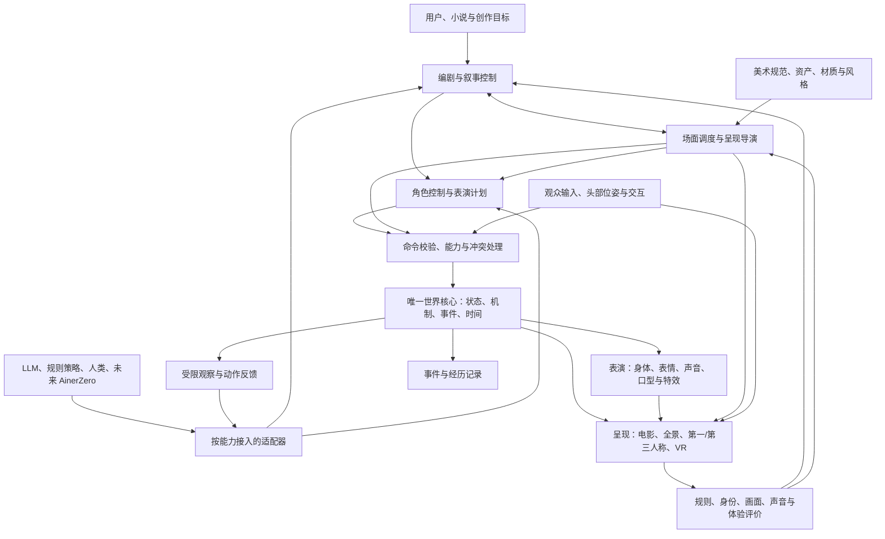

# AnimeWorld：世界、表演、导演与沉浸叙事的统一参考架构

日期：2026-10-15（Europe/Istanbul）；主责：Codex。  
性质：规划提案，整合本轮用户关于超现实变形、电影导演、美术、角色状态、交互剧情、全景与 VR，以及 LLM/AinerZero 接入的要求。不是实现、验收或运行授权。

本文件归属本次 Codex 审议目录，不修改 Claude 持有的根目录规划或已接受 ADR。前序 [首次审议](PLAN.md)、[运行职责补充](ARCHITECTURE_ADDENDUM_R2.md)、[多世界抽象](MULTIWORLD_ABSTRACTION_R3.md) 保留。本文给出统一结构，后续应由当前主责整合为同一份正式实施基线。

## 1. 架构定位

AnimeWorld 应是一套**可执行世界、角色表演和叙事制作平台**。整体需要具备生成世界、美术设计、表演、摄影、剪辑、交互故事及体验组织能力。

世界核心管理对象、身份、规则、状态、时间和事件。电影学、美术和剧情策略在使用世界核心的制作/导演层。AinerZero 是未来可提供预测与决策能力的学习模型。职责分开，才能既保留创作能力，又让实时世界不依赖每帧调用 LLM。

“由 LLM 驱动”可以表示目前只有现成 LLM 提供高层创作与规划智能；它仍然调用资产、规则、动作、声音和渲染工具。单独一段 LLM 文字输出，不构成可执行的世界或电影。将同一模型部署成多个职责也可以，但角色状态、信息权限和调用记录必须分开。

目标是可扩展、可验证、可替换；不能预先保证任意创意、题材、角色规模或设备上都能实时且有电影品质。

## 2. 四种状态与四种计划

### 2.1 状态的唯一归属

| 状态 | 保存什么 | 谁可提交修改 |
|---|---|---|
| 世界状态 | 对象、形态、物理/特殊机制、空间、动作、接触、时间、事件 | 世界核心接纳经过校验的命令/模拟结果 |
| 角色状态 | 自己的观察、记忆、目标、信念、关系、情绪、身体状态、当前行为 | 角色运行时按收到的观察和已提交结果更新；不能由无关角色随便覆盖 |
| 叙事会话状态 | 当前戏剧节拍、冲突、已触发事件、待揭示信息、剧情承诺、分支 | 叙事控制器消费事件后更新 |
| 观众体验状态 | 观看模式、角色身份、位置/朝向、交互、实际呈现/可能注意到的信息、体验偏好 | 体验运行时与输入设备/用户交互更新 |

导演的全局规划信息、世界私有状态和角色真正知道的信息必须区分。没有看见或听见的角色，不能因为导演知道某秘密就自动知道。观众注视不自动等于理解，观看记录也不能直接写成用户主观信念。

### 2.2 计划不能混成一个提示词

| 计划 | 回答的问题 |
|---|---|
| 世界/场景计划 | 这里有什么？遵循什么机制？资产、材料、空间和关系是什么？ |
| 叙事计划 | 当前人物想要什么？冲突、转折、信息揭示和结果是什么？ |
| 表演计划 | 谁在何时做动作、说话、停顿、注视、反应？道具怎么交接？ |
| 呈现计划 | 观众以什么方式看到/听到？镜头、剪辑、全景或 VR 注意力如何组织？ |

计划是候选；已经发生的结果进入不可改写的事件记录。自由交互产生新的剧情分支后，不能继续宣称它与原电影发生了完全相同的事情。

## 3. 统一结构

这是一份逻辑分工，不要求拆成十几个微服务。沿用模块化单体加独立计算 worker；Relay 继续派工程任务和监督有界作业，不承担每个角色逐 tick 的产品运行循环。

## 4. 书包变大象与橡胶身体：身份、形态和事件分离

### 4.1 先解释变化究竟发生在哪一层

| 创作意图 | 世界记录 |
|---|---|
| 只是镜头中的幻觉、想象或转场 | 表现/叙事事件；记录谁看到了什么，不自动修改实际身体和碰撞 |
| 同一个存在真的变成另一形态 | 持续实体/人物身份，加版本化形态转换事件；身体、动作和交互能力相应切换 |
| 原物件消失并生成新生命 | 原实例结束，新实例生成；记录来源谱系、位置与时间及新控制者 |

因此需要分开：

1. **持续身份**：故事中的“谁/哪一个存在”，及其关系与经历。
2. **当前身体/形态**：Mesh、Rig、材质、碰撞、动作接口、声音配置、能力和有效时段。
3. **控制归属**：当前由剧本表演、规则策略、LLM、人类或未来 AinerZero 控制；只有一个生效写入者。

物件变成人物时，不应自动继承一个未定义的意识、记忆或人格。是同一角色变身、附身、伪装，还是新生命诞生，必须在创作计划里区分。

### 4.2 一个变形事件至少包含

源对象/形态 → 目标形态与资产版本 → 触发条件 → 生效时刻和过渡过程 → 身份连续性 → 身体/碰撞/能力变化 → 角色反应 → 可见/可听效果 → 结束或逆转方式。

橡胶人伸长手臂可由专门 Rig、变形器、程序化曲线或已登记动画驱动。不同拓扑的书包与大象，需要相应资产、对应关系/过渡方法或明确的遮挡/闪光转场。支持某一种形变不能泛化成“任意物件任意变化都已可用”。

物理互动与渲染变形需匹配：手臂变长后能否碰到远处按钮、身体是否穿墙、变形是否受力，都要按所选规则执行。若只是视觉夸张，就不能在物理经历里伪装为身体真实变长。

### 4.3 对当前 ACIS 的影响

现有 `docs/ACIS.md` 用固定网格、骨骼比例、调色板防止无意漂移，适合原有角色范围。超现实变身需另写 ADR/新契约，扩成“持续身份＋多个不可变形态包＋显式转换事件”。

每个形态仍锁版本和允许变形范围。原 Gate ID 的金样与门保持历史身份；新形态与转换路径另登记验收，不能通过放宽旧门把角色漂移解释成变身。自动视觉比较需知道此刻预期的形态与变化范围。

## 5. 怎样让画面好看

画面质量需要四组可执行资源和反馈，LLM 可以为它们提出方案，但不能只靠长提示词维持一致：

| 资源 | 内容 | 主要检查 |
|---|---|---|
| 项目美术规范 | 形体语言、色板、主次、材质尺度、光照、时代道具、风格混搭规则 | 主体可读、风格一致、各镜头美术连续 |
| 资产与制作工具 | 已登记角色/道具/场景、参数化生成器、Rig、动作与材质库 | 资产和任务匹配；几何、绑定、接触、预算正确 |
| 镜头美术计划 | 构图、景别、焦距、光比、遮挡、前中后景、注意力重点 | 该镜头是否传递预定信息与情绪 |
| 预演与评价 | 构图小样、代表帧、连续片段、局部重渲染和独立评价 | 身份/时序/声音正确，并有人类或独立视觉证据支持美术改进 |

混合赛博朋克、橡胶人和写实材质时，应定义主导风格、局部覆盖及转换边界。题材可以混合，视觉层次仍需有目的。物理灯光与美术补光、真实身体与镜头矫形分别记录。

本项目已有 Asset Hub、Style Pack、Render Critic 的设计归属；当前缺口是运行时工具、表演与导演的数据闭合和真实验收。复用现有 Studio/Director/场景协议入口，先核当前支持范围，不另建视频生成 UI。

## 6. 怎样把事件导演成电影

电影导演首先确定一个节拍要让观众感受/知道什么，再选择表演和镜头。

例如“书包变大象”：

| 节拍 | 戏剧作用 | 表演与画面候选 |
|---|---|---|
| 建立 | 让观众认出书包、人物和空间 | 空间关系清楚的中/全景；角色拿起或指向书包 |
| 预兆 | 产生预期与悬念 | 包扣松动、角色停顿、异常声；根据叙事目标选择是否提前露出 |
| 转变 | 显示关键变化与因果 | 形态转换、身体避让、碰撞/道具互动与音效 |
| 反应 | 让事件影响人物 | 一人惊讶、一人镇定或隐瞒；目光与对白各有依据 |
| 结果 | 推进下一行动 | 大象阻路或触发新冲突，人物改变目标 |

随后由摄影/剪辑层形成多个 coverage：建立镜头、动作镜头、说话者、听者反应、道具特写等。它们引用同一已记录表演和事件时间，不各自重造世界。

电影语言知识应保存为目的、可检索样例、候选语法和约束：景别、视线匹配、动作连续、空间轴线、反应镜头、节奏、信息隐藏/揭示、对白前后的停顿。技术连续性可以自动检查，艺术性可以有意打破惯例并记录意图；规则全过不等于作品精彩。

对外部实现的参考：[Epic Camera Cut Track](https://dev.epicgames.com/documentation/unreal-engine/cinematic-camera-cut-track-in-unreal-engine) 区分表演序列和活跃相机/切换。这里只参考责任分离，不表示本项目已接入 UE 或更换主引擎。

## 7. 角色怎样自然行动，其他人怎样反应

角色状态应至少覆盖：

- 持续身份、当前形态/身体、控制者及动作能力。
- 当前可用的观察、记忆、知识、秘密与错误信念。
- 目标、关系、当前情绪与可用于行为的身体状态。
- 当前行动、计划、对话状态、道具持有与交互占用。
- 动画、姿态、注视、表情、声音与口型的执行状态。

角色策略产出“说什么/想做什么”的提案，表演系统负责可执行动作、接触、时序与声音。观察到事件的角色根据各自关系和目标反应；未观察到的角色不应无缘无故同步惊讶。

实时运行分层：

1. 叙事/导演在事件和场景节拍上选择目标。
2. 主要角色的 LLM 或未来策略在需要决策时规划。
3. 导航、动作执行、表情过渡、口型、物理和渲染由确定的本地运行时持续推进。
4. 远处/背景角色用较低成本的行为规则或汇总模拟；不强制每人每帧独立调用 LLM。

模型请求可以异步返回；提案必须带观察版本、有效期限和控制范围。过期计划不能覆盖新状态。模型暂时不可用时，用登记的待机/既有计划/规则策略降级，世界不因此整段冻结。精确延迟、频率与人数需后续实测，不在本文承诺。

## 8. 电影、全景和 VR：同一世界，不同呈现与参与方式

| 模式 | 谁控制观察视角 | 导演主要控制什么 | 关键限制 |
|---|---|---|---|
| 传统电影 | 摄影/剪辑系统 | 景别、机位、运镜、切换、节奏 | 需要镜头连续与表演重拍能力 |
| 预录全景电影 | 观众转头；拍摄路径预定 | 场面走位、声音、光线、事件节奏；必要的空间转场 | 不能凭全景视频声称可自由移动或改变故事 |
| 第一/第三人称交互世界 | 用户输入与声明的相机模式 | 相机辅助、场景事件、对话、互动反馈 | 是否允许接管镜头须由体验模式明确 |
| 六自由度 VR 叙事 | 头部位姿与用户移动/输入 | 空间叙事、注意力引导、角色响应与可选场景过渡 | 不能直接套用电影剪辑表，也不默认强迫用户转头或平移视点 |

交互系统需要区分观众是旁观者、世界中的参与者，还是接管一个角色。旁观摄像机不自动成为有碰撞/可被 NPC 看见的身体；参与者则有明确身体、感官和行动权限。

VR 的“反应镜头”可以转译成：角色走入合适的视野、转头看向关键事件、方向性声音、灯光/运动引导，或稍后重新呈现错过的信息。不能把所有“切人物特写”直接实现为强制改变观众头部朝向。

设备层提供观众位姿是独立职责，例如 [WebXR Device API](https://www.w3.org/TR/webxr/) 定义设备与观察者相关接口。本文不选定 WebXR 技术栈，也不把接口支持当作舒适体验或真实头显验收。

### 8.1 交互剧情的触发与推进

触发条件可以包括进入区域、看向对象、使用道具、与角色说话、完成事件或改变关系。它们需要前提、一次性/冷却、有效时间、取消和失败路径，保证事件提交有明确身份、不会重复消费。

叙事控制器维护：待执行节拍、前置条件、关键事实、角色目标、可调整部分和已发生分支。用户走开、打断对白或提前拿书包时，选择延迟、改由其他角色说明、改变事件位置、接受失败/新分支等明确策略。不能一边宣传自由参与，一边隐蔽抹掉用户行为恢复原剧本。

剧情与自主角色之间的协调已有研究先例。[Façade](https://ojs.aaai.org/index.php/AIIDE/article/view/18722) 把反应式角色行为与由 drama manager 组织的故事节拍结合。这里只借鉴层次分工；该工作不证明开放世界、现代 LLM、任意剧情或本项目已经达到相同能力。

## 9. 声音、对白与多人反应共用时间

离线作品继续采用用户偏好的主音频优先：先锁对白/声音表演，再安排动作、镜头和口型。多人场景还要表示谁说、对谁说、谁能听见、谁在等轮次、是否打断和动作何时反应。

交互时，尚未发生的对白可预生成候选或按事件生成；实际采用的音频确定后再安排对应表演，允许取消后续计划并记录结果。既有已发生事件和音轨不倒改，不能把实时世界随意拉伸去容纳新台词。

模拟 tick、音频采样时间、呈现时间与设备输入时间之间需要明确映射。多人表情/动作、声音和视线引用同一个事件身份。语言版本、演员更换和形态变化后的声音绑定单独登记。

现有 PERFORMANCE 文档主要是日漫 5/6 口型的设计。超写实和不同身体需要自己的口型/面部 Rig 与评价配置；不能用原动漫口型门宣称所有写实对白已通过。旧文档里的服务可用性和速度数据，本次没有复测。

## 10. LLM 与 AinerZero 共用什么接口

**统一任务语义和执行接口，按能力提供方替换；不强迫不同模型拥有相同的输入和全部技能。**

| 接口职责 | 内容 |
|---|---|
| 观察视图 | 视点/角色、世界/身体版本、可见/可听事件、感官数据、允许的结构化信息 |
| 能力描述 | 可执行技能、参数与动作 schema、身体/Rig兼容、时间范围、已验证环境、失败与回退 |
| 决策请求 | 当前任务、目标/约束、允许动作、预算/截止、上下文与控制权限 |
| 行动提案 | 有类型的行动/表演/镜头/编辑计划，依据的状态版本、控制者与有效范围 |
| 校验和提交 | 前提、世界规则、身体可达、道具占用、控制冲突、revision与权限 |
| 结果反馈 | 接受/拒绝、实际发生、部分完成、中断/失败、后续可感知事件 |
| 记忆与经历 | 按角色、世界/分支、身体和策略版本隔离；记录来源和辅助 |

角色行动、世界预测、导演规划、视觉评价是不同技能。它们可以使用同一协议体系，但不能因为某模型会预测位置，就授予它写对白或导演整部电影的能力。

可行的未来组合包括：

- LLM 继续编剧和导演，规则运行时控制普通 NPC，AinerZero 仅提供某项世界预测。
- AinerZero 接管已验证的行走/交互决策，LLM 继续负责语言与剧情。
- 某些角色由人类控制，其余角色由不同策略控制。

每个生效控制范围只有一个提交者。导演可以提供目标或受控表演指令，但不能与角色策略同时直接改同一关节或角色位置。切换控制者要有明确事件和状态交接。

### 当前接口边界

AinerZero 现有观察是 8 格符号，动作是 0–3；完整 3D 身体、视觉/声音、变形与交互动作都不是现成兼容。Bridge 已列 AZ-X1–X5 的部分方向。本架构提供未来接入位置，不能声称当前模型插上就能演出或导演。

形态变化使身体/动作接口不兼容时，原策略必须重新确认能力范围，不能继续套用旧动作。AinerZero 接入应先观察、影子提案、沙盒，再在独立验证的技能范围内执行。训练仍暂停；未来模型是否达到相关能力是独立研究结果，无法由接口设计保证。

LLM 给出的规则、导演调度、脚本动作、仿真结果和学生自己的行动分别保留来源。受导演精确控制的表演不登记为学生自主发现；公开观察不暴露隐藏机制或角色秘密来制造虚假的理解成绩。

## 11. 存储与回放：一份世界，多种制作与体验产物

建议共用以下可版本化记录，不为每个职责发明一个新的大文件格式：

1. 世界源与 `.aworld` 清单、机制包、资产/形态/风格引用。
2. 叙事意图、节拍/条件及作者来源。
3. 实际提交的世界事件、快照和角色观察/决策。
4. 表演 take：身体、注视、表情、道具、对白和口型轨。
5. 呈现计划：电影镜头/EDL，或全景/交互体验配置。
6. 渲染、声音和评价产物，带依赖摘要和已知限制。

同一已记录事件和表演可以从不同相机重拍，也可出一份预录全景版本。交互观众改变事件后形成新 session/分支，再记录后重拍。不要承诺所有模式永远共用完全相同的时间线。

编辑资产、机制、音频或表演后，只标记相关依赖和镜头需要重建；旧 take、旧世界和失败保留。`.apack` 用于相应用途的不可变素材/经验视图，不把生产存档自动准入训练。

## 12. 对现有规划的具体增补

| 责任范围 | 当前可复用 | 需要补的设计/实现 |
|---|---|---|
| 世界与规则 | 内核、日志、Scene Compiler、多世界/机制规划 | 交互运行、规则组合、形态转换与事件契约 |
| 人物与表演 | ACIS、已有表情/注视数据、PERFORMANCE设计 | 持续身份/多形态、完整角色状态、角色控制与多人反应 |
| 创作与导演 | 上游 Director/scene协议、v8 Creative Brain与Shot Planning | 节拍/剧情会话、场面调度、镜头语义与独立质量评价 |
| 美术与资产 | 风格包、Asset Hub与程序化生成器计划 | 美术规范、资产/材质/动作适配、预演评价闭环 |
| 呈现与参与 | EDL、Godot回放原型、Blender主路径计划 | 电影/全景/交互/VR的不同呈现策略、用户控制归属 |
| 智能接入 | v2经历、Bridge扩展方向、能力路由设计 | 产品运行时的 typed skill 接口、异步有效性、控制切换与降级 |

旧协议和已验收工程按原范围保留；涉及 ACIS、权威状态推进和不同身体的扩展应先由主责整合 ADR。此表不是自动新建任务或恢复 Godot/T10 的授权。

## 13. 最小验证场景

建议沿用小场景推进，不先造万人社会和完整自治平台：一间房、两名角色、一个书包及一种明确变形机制。

| 验证 | 应得到的证据 |
|---|---|
| 世界事件 | 书包变大象有稳定身份/谱系、形态与碰撞变化、明确触发和重放 |
| 身体能力 | 橡胶手臂接触远处物件，身体/动作与反馈一致；只做视觉变形时明确标注 |
| 角色 | 看见事件的人按目标/关系产生不同反应；未观察者不自动知道 |
| 电影 | 依据同一表演出动作、对白、听者反应与道具镜头；声音和连续性成立 |
| 参与式体验 | 用户提前拿包、走开或打断时出现明确延迟/取消/分支；没有重复触发 |
| 多种呈现 | 同一记录出电影与自由观看版本；自由视角不暗改世界身份与因果 |
| 模型接入 | 首先用规则策略与LLM适配做同一技能的结果对照；AinerZero只设计接口，不运行 |
| VR | 桌面自由相机只能证明相应原型；真正头显还需设备、位姿、性能与体验独立验收 |

先验收“一个事件能正确发生、被人物感知、被导演组织、被观众以不同方式体验”。有了这条链，才逐步增加变形种类、角色数量、世界区域和创作复杂度。本文不新增渲染/模型预算。

## 14. 证据范围

本次只读核对 AWZ 的 README/COORDINATION/AGENT_TASKS/RESEARCH_LOG、v8、ACIS、Performance、小说对接、Bridge、Scene Compiler与角色状态源码，以及 AinerZero v2 经历源码。当前场景编译器明确只支持有限动作/相机子集，不能从设计文档推断全部表演已实现。

公开研究/文档仅支撑对应分工参考，不构成本项目的运行证据。具体来源身份见同目录 `r4-sources.json`。

本次没有改实现、运行测试/模型/渲染、派发任务、部署、提交或推送；没有恢复 AinerZero 训练。
